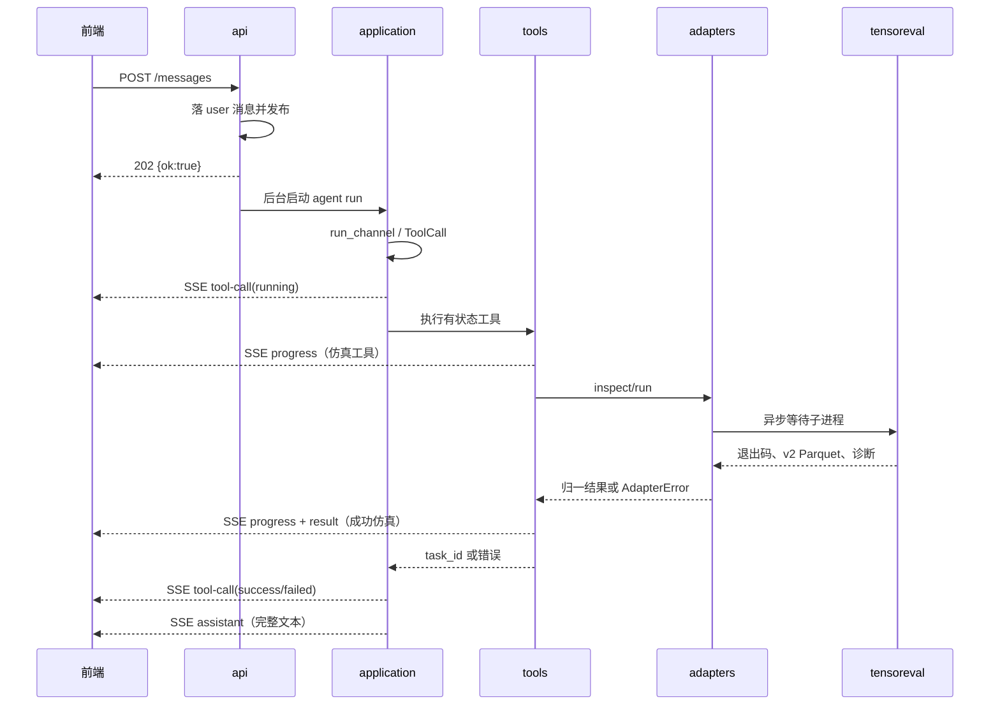

# 后端架构设计

> 版本：v1 已实现基线 + v2 分阶段实施中
> 配套：数据库设计见 `docs/db-design.md`；前端契约见 `frontend/src/types/index.ts`
> 说明：本文同时记录 v1 实现基线与 v2 目标架构；标为目标或待实现的内容不能当作当前能力。引擎结论以
> `../eig-rs/sparrowzz/dss/docs/` 为准（见 db-design §0）。
> 模型上传、版本、DataFrame 推断与对比的完整目标设计见 `docs/model-workspace-design.md`。
> Agent prompt、领域技能和引擎知识版本管理见 `docs/agent-prompt-skills-design.md`。

---

## 0. 目标

本项目最初从单文件 demo（`main.rs` 硬编码工具）起步，v1 已演进为**分层、可扩展、可观测**的
服务；本文同时定义 v2 模型工作区的目标边界。核心能力：

1. 把一个 rig agent 的「黑盒对话循环」变成**结构化事件流**，前端能实时渲染工具调用、进度、结果；
2. 落实 AGENTS.md 的硬约束：**所有内核调用收敛到 `adapters/` 适配器层**；
3. 把「同步阻塞的引擎 CLI」包装成「有状态、可追溯的异步仿真任务」。
4. 把分批上传的文件组织成不可变模型版本，使修改、重跑、查询和前后对比可复现。

---

## 0.5 会话归属：v2 已实现的身份边界

v2 不在应用内维护账号密码，而是使用部署实例身份或可信认证代理提供的主体。身份 extractor、
`storage_scopes`、带 scope 的 repository、`/api/me`、内容寻址 artifact、只读配额接口和不可变模型
工作区已实现；摄取和历史等后续资源沿用同一边界。

- **并发不等于多用户隔离**：`session` 和事件流可以并发运行，但 v1 没有身份与归属过滤；不同浏览器
  会看到同一实例的全部历史会话，因此只适合可信单用户/单租户部署。
- **不做的（v1）**：账号注册/登录、认证中间件、多租户数据隔离、权限/角色。
- **会话归属语义（v1 定死）**：所有 `sessions` 属于当前部署实例，`GET /api/sessions` 返回全部。
- **v2 不迁移 v1 数据**：原型未投入使用，发布前重建干净 schema，不保留无归属 session、旧消息或
  CSV 结果的兼容分支。
- **v2 身份模式**：`AUTH_MODE=instance` 仅供可信私有单租户；公开多人部署必须使用
  `AUTH_MODE=trusted_proxy`。认证代理完成登录、移除外部同名头并注入 subject/tenant 与代理 token；
  Axum extractor 把它解析成不可变 access scope，应用本身不保存密码。
- **repository 强制过滤**：已实现的 Session/Message/Task 查询都接收非可选 access scope；Artifact
  通过服务端解析的 storage scope 计费；后续 History repository 必须遵守相同规则；
  不能提供“未传 scope 就返回全量”的重载。跨 scope 的已知 ID 与不存在 ID 都返回 404。
- **当前代理 scope 规则**：无 tenant 时使用 `owner:<subject>`；有 tenant 时使用
  `tenant:<tenant>:owner:<subject>`。同 tenant 下的不同 subject 仍相互隔离；scope 只能由请求头
  extractor 产生，不能由请求体或 URL 指定。
- **前端恢复分区**：`GET /api/me` 返回稳定的 `scopeKey`；浏览器的上次会话键必须组成
  `zjudss:last-session:<scopeKey>`，避免切换主体后恢复另一个主体的导航状态。
- **历史文件配额**：instance 模式按整个实例计算；trusted_proxy 模式按 owner/tenant 计算。默认
  20,000 个唯一 artifact、20 GiB，达到上限只拒绝新增持久文件，不影响已有历史读取。

---

## 1. 立项基线与 v1 落地结果

| 关注点 | 立项基线 | v1 已落地 |
|---|---|---|
| 工具定义 | `#[rig_tool]` 硬编码在 `main.rs`，返回 `"model ok"` / `"task-0001"` | 独立 `tools/`，有状态实例，走适配器 |
| 适配器层 | **不存在**（AGENTS.md 要求） | `adapters/` 作为内核唯一边界 |
| agent 生命周期 | 每个请求重建，`agent.prompt()` 一次性返回文本 | 每条用户消息构建一次短生命周期 run + 流式驱动；不按用户常驻 |
| 输出形态 | `{ reply }` 单次 JSON | SSE 结构化事件流（对齐前端 6 类消息） |
| 会话持久化 | 无（DB 已建但未接入） | 全链路落库，DB 为持久化真相 |
| 仿真执行 | 无（硬编码 task_id） | 子进程跑引擎 + 限流 + 状态机 |
| 模型输入 | 无附件链路 | 单附件可保存并回显；agent 仍需从消息获得服务器路径 |
| 版本与对比 | 无 | 属于 v2：任务绑定不可变模型版本，比较绑定两个历史任务 |

前七项已经实现到表中所述的 v1 范围。单 RSS 自动建模、bundle、多 DataFrame、active/draft、历史检索和任务比较是 v2 目标，
不能按本表中的 v1 能力对外宣称已完成。

---

## 2. 前端契约（决定后端输出形态）

当前前端 `types/index.ts` 把消息定义为 6 类 discriminated union，后端的已实现事件流必须能映射到这 6 类：

| 前端类型 | 关键字段 | 后端事件来源 |
|---|---|---|
| `user` | content | 入站消息（直接落库、回放） |
| `assistant` | content(Markdown) | `StreamAssistantItem::End` 的完整文本 |
| `tool-call` | toolName / args / status(running\|success\|failed) / summary | 工具调用的开始与结果 |
| `progress` | taskId / stages 数组（pending/running/done/failed） | 仿真任务阶段推进 |
| `result` | taskId / title / metrics(maxVoltage·minVoltage·violationNodes·violationDuration) | 工具根据适配器聚合值发布并落 `messages` |
| `attachment` | file 信息 | v1 上传文件的回显 |

**推论**：后端必须把 agent 循环内部发生的「调用工具 → 工具执行 → 出结果 → 最终回复」逐条
**发布成事件**，而不是等 agent 跑完一次性返回。这是本架构的轴心。

目标工作区功能增加 `model-status` 和 `comparison` 两类消息。它们尚未写入
`frontend/src/types/index.ts`，属于 v2 契约；实现前必须同步修改前端权威类型、后端 DTO、落库映射和
回放测试，不能只在后端私自增加事件变体。v2 同时升级 `progress`（operation 命名空间）、`result`
（DataFrame 输出引用）和 `tool-call`（稳定 callId）；由于 v1 未投入使用，旧消息不做兼容回放。

---

## 3. 分层架构

自顶向下六层。主要业务依赖向下；v1 工具为实时落库和推送持有一个
`application::EventWriter` 回调，这是当前明确的反向端口，而不是内核调用旁路：

```
┌──────────────────────────────────────────────────────────┐
│ api（HTTP 层）    axum router / handler / DTO / SSE        │
│   POST /api/sessions/{id}/messages   触发 agent，返回 ack  │
│   GET  /api/sessions/{id}/events     SSE 订阅事件流         │
│   GET  /api/sessions/{id}/messages   回放历史               │
│   GET  /api/tasks/{id}/curves        曲线                   │
├──────────────────────────────────────────────────────────┤
│ application（编排层） 会话编排 / 事件总线 / 限流              │
│   ChatService、AppState、EventBus                           │
├──────────────────────────────────────────────────────────┤
│ agent（agent 层）   provider 选择 / preamble / 工具装配       │
│   agent::build_agent；run_channel() 由 application 驱动      │
├──────────────────────────────────────────────────────────┤
│ tools（工具层）   有状态实例：adapter + repository + writer  │
│   InspectModel、RunSimulation（+ 未来更多）                 │
├──────────────────────────────────────────────────────────┤
│ adapters（适配器层） 内核唯一边界（AGENTS.md 硬约束）         │
│   SimEngine：inspect / run（子进程 + 错误码翻译）            │
├──────────────────────────────────────────────────────────┤
│ db（持久层）   Diesel pool + repository（6 表）             │
│   SessionRepo / MessageRepo / TaskRepo                      │
└──────────────────────────────────────────────────────────┘
```

职责与关键约束：

- **api**：只做 HTTP 协议与 DTO 转换，不含业务逻辑；SSE 端点把内部事件序列化为前端消息。
- **application**：持有 `AppState`（连接池、事件总线、限流信号量、引擎适配器、LLM 配置；v2 增加
  只读 `EngineResourceSnapshot`），
  编排一次对话的生命周期；是唯一知道「如何把一次 chat 变成 agent run + 落库 + 推事件」的地方。
- **agent**：`agent/mod.rs` 负责 provider 选择和 agent 组装；`application/chat.rs` 用
  `run_channel()` 驱动并消费事件。
- **tools**：**有状态实例**（见 §5），调用 `adapters`、任务 repository 和事件写入回调；绝不直接碰
  内核 API。当前事件回调的具体类型是 `application::EventWriter`，若后续拆 crate，应把它下沉为中立
  port/trait，避免形成包级循环依赖。
- **adapters**：内核地址、鉴权、错误码翻译、子进程生命周期都收敛在此。
- **db**：6 张 v1 表、模型和 Session/Message/Task repository 已就绪，上层不直接拼 SQL；
  `task_files/task_results/curve_data` 的写入链路仍未接入，且后两张表只保留为遗留 schema；v2 目标见
  db-design §7.8。

---

## 3.5 Prompt 与领域知识的来源与管理

rig 不会自动扫描本项目的 prompt/skill 文件；当前组装入口都由代码显式提供：

- **系统提示词**：`resources/agent/v2/system.md` 通过 `include_str!` 编译进后端，并由
  `AgentBuilder::preamble()` 注入；skill index 作为固定静态 context 注入。
- **工具（可执行动作）**：Rust `Tool` 实现（`#[rig_tool]` 或手动 impl），`description()` 自动进模型
  schema，不等同于本文定义的领域技能。
- **上下文知识**：`AgentBuilder::context()`（静态）/ `dynamic_context()`（动态检索）。
- rig 里的 `Skill` 是 Anthropic 容器扩展专属（code-execution container 预加载技能），与
  DeepSeek / 本项目无关。

**本项目"配电网仿真知识"的真实来源是引擎 docs**，尤其 `agent_quickstart.md`
（需求→分析类型→DSA 函数→RSS 脚本的步骤）、`dsa_function_reference.md`（函数签名）、
`dataframe_schema_reference.md`（结果表与单位）、`rss_language_reference.md` 与
`rsdss_function_reference.md`（DataFrame 筛选、连接、聚合和脚本语法）、`simulation_recipes.md`（配方）。

**v2 已实现的资源层**：系统规则与领域技能编译进后端；引擎文档、机器合同和案例从
`${TENSOREVAL_CWD}/sparrowzz/dss` 在启动 preflight 中生成只读快照，分层注入：

| 层 | 来源 | 内容 |
|---|---|---|
| `preamble` | `resources/agent/v2/system.md` | 角色定位、行为规则、稳定 ID 和安全边界 |
| 技能索引 | `resources/agent/v2/skill-index.json` | 技能 ID、触发条件和所需工具，每轮固定注入 |
| 按需技能 | `resources/agent/v2/skills/*.md` | 研究规划、RSS 生成、结果分析、比较和故障处理步骤 |
| 引擎文档 | resource snapshot 的 `docs-index` | 按标题切分并全文索引，通过受限只读工具按需取 section |
| 机器合同 | resource snapshot 的 `catalog/*.json` | 函数签名、schema、单位与稳定键，供程序校验和只读查询工具使用 |
| 案例目录 | resource snapshot 的 `examples.json` | 已验证 RSS/rssbundle 的说明、能力要求、依赖闭包和 hash |
| 工具说明 | `Tool::description()` | 代码内，不进文件 |

当前每轮只注入精简技能索引；后续工具任务在需要生成或诊断脚本时调用 `load_agent_skill`，再按需调用
`search_engine_docs/read_engine_doc_section`。脚本写工具检查本轮已加载的技能，catalog 和脚本验证器仍
对最终输出做确定性校验。后端不硬编码 `../eig-rs`，只读取配置根内允许的 docs/catalog/examples；运行
期间使用已发布 snapshot，防止文件变化造成同一进程内合同漂移。具体来源、资源布局、案例导入、版本字段
与测试规则见 `docs/agent-prompt-skills-design.md`。

---

## 4. 核心机制一：结构化事件流（rig `run_channel` → 前端消息）

rig 0.45 提供了把 agent loop 拆成「驱动 future + 事件 feed」的能力：

- `AgentRunner::run_channel()` 返回 `(Future<PromptResponse>, RunEvents)`，
  `RunEvents: Stream<Item = MultiTurnStreamItem>`；
- `MultiTurnStreamItem` 含：`ToolCall`（工具调用已提交）、`ToolExecutionCommitted`、
  `ToolResult`、`StreamAssistantItem`（模型文本/工具参数流）、`CompletionCall`、
  `FinalResponse`（最终回复）。

**映射**（在 application 层做）：

| MultiTurnStreamItem | 前端消息 | 说明 |
|---|---|---|
| `StreamAssistantItem::End` 的文本 | `assistant` | 当前实现写入一条完整 Markdown |
| `ToolCall` / `ToolExecutionCommitted` | `tool-call`(running) | 工具开始 |
| `ToolResult`（成功） | `tool-call`(success, summary) | 工具结束 |
| `ToolResult`（失败） | `tool-call`(failed) | 工具失败 |
| 工具体内发布的阶段事件 | `progress`(stages) | 引擎运行期间实时推进 |
| 工具体内发布的 result 事件 | `result` | 仿真指标 |

`FinalResponse` 和非文本流事件不直接映射；当前只在 `StreamAssistantItem::End` 收到完整文本时
写入 assistant 消息。若以后需要 token 级流式，必须新增独立 `assistant-delta` 契约和恢复语义。
v2 的同一次工具调用为 running 与
success/failed 事件分配不同消息 ID、相同 `callId`，前端据此更新一张工具卡。

**关键细节**：`ToolCall`/`ToolResult` 是**批量提交后**才成对出现，不是实时 start 通知（rig 文档
明确说明实时观察要靠 tool hook 或工具体内副作用）。因此「`running` 状态 + `progress` 阶段推进」
这类**实时中间态**由工具实例在体内主动发布（见 §5/§6），而不是等 rig 的 ToolResult。

**传输**：`GET /api/sessions/{id}/events` 用 SSE（`text/event-stream`）单向推送，天然契合
「后端产生、前端消费」的模型；事件同时落库，DB 是持久化真相，SSE 只负责实时性（断线后由
`GET /messages` 回放补齐）。

**事件总线**：每 session 一条 `tokio::sync::broadcast`（有界、可丢最旧），挂在 `AppState`
的 session 注册表里；工具与编排层往对应 session 的 channel 发事件，SSE 端点订阅并转成前端消息。

---

## 5. 核心机制二：有状态工具 + 适配器边界

早期 `#[rig_tool]` 生成的是**无状态 unit struct**，无法感知 session/DB/事件总线。v1 已改为手动
实现 `Tool` 的有状态实例。rig 0.45 的
`Tool::call(&self, context, args)` 是**异步实例方法**，且官方文档明确「`Arc<Mutex<_>>`、channel
等共享状态属于工具实例，不属于 `ToolContext`」。因此工具写成**有状态实例**：

```rust
// 概念示意，非最终代码
struct RunSimulationTool {
    services: Arc<ToolServices>,  // session / writer / task repo / semaphore / engine
}

impl Tool for RunSimulationTool {
    type Args = RunSimulationArgs;     // v1: model_path/script_path；v2 改为 version/study spec
    type Output = String;              // 返回 task_id 给 agent
    type Error = AdapterError;         // 错误码已由适配器翻译

    async fn call(&self, ctx: &mut ToolContext, args: Self::Args) -> Result<String, AdapterError> {
        // application 已根据 ToolCall 落 tool-call(running)
        // 1. 取得 semaphore permit，创建 simulation_tasks
        // 2. 发布 progress，只通过 self.services.engine.run(...) 调内核
        // 3. 更新 task，发布最终 progress/result
        // 4. 返回 task_id；application 根据 ToolResult 发布 tool-call 终态
        Ok(task_id)
    }
}
```

- **每次请求构建一套工具实例**（携带绑定 session 的 `Arc<ToolServices>`），随 agent 一起创建，
  绕开「agent 如何注入 ToolContext」的不确定点，最稳妥。
- **适配器是唯一内核边界**：工具只调用 `services.engine`（`adapters::SimEngine`）暴露的
  `inspect()` / `run()`；内核地址、鉴权、错误码翻译、子进程参数拼接全部在 `adapters/` 内。
  AGENTS.md 硬约束由此落实。

`inspect_model` 同理：不再是硬编码 `"model ok"`，而是调用 `SimEngine::inspect()`（对应引擎
`import_dss` 的解析步骤，fail-closed + 诊断，见 db-design §0.4）。

---

## 5.5 Agent 生命周期、并发与容量

这里的 `Agent` 是一次模型调用循环的配置与工具注册表，不是 OS 进程，也不是为某个用户常驻的后台
服务。当前链路是：每次 `POST /messages` 启动一个后台任务；`ChatService::run` 为该条消息新建有状态
工具和 `Agent`，从数据库加载同一 session 的历史，完成后释放。因此会话连续性来自数据库与
`session_id`，不依赖一个长期存活的 agent。v1 尚无账号体系，也不存在“每用户一个 agent”的归属关系。

rig 0.45 的 `AgentBuilder::build()` 只组装 `Agent`、handler 表和 `ToolServerHandle`；
`ToolServer::run()` 创建的是共享注册表句柄，不会为每个 agent 启动常驻线程。需要管控的是同时运行的
agent run、LLM 请求和工具执行，而不是已构建的 `Agent` 结构体数量。

当前容量边界如下：

| 边界 | v1 现状 | 含义 |
|---|---|---|
| 单次 run 模型轮数 | `MAX_TURNS = 8` | 防止模型与工具无限循环；不是 agent 数量上限 |
| 实例级 agent run | 无应用层上限，每条消息直接 `tokio::spawn` | 突发消息可能同时占用 LLM 配额、内存和 DB 连接 |
| 同一 session 的 agent run | 无串行化 | 多条消息可能基于不完整历史并交叉写入事件 |
| 仿真内核执行 | `Semaphore(4)` | 最多 4 个 `tensoreval` 子进程；不限制纯问答/检查阶段的 LLM 并发 |
| SQLite 连接池 | 8 | 这是数据库资源上限，不可替代 agent admission control |

v2 在 application 层增加独立的 agent 调度器，目标规则定为：

1. **同一 session 同时只运行 1 个 agent run**，后续消息按消息 ID 排队，保证历史与事件顺序；
2. **实例级活动 run 默认最多 8 个**，由 `AGENT_MAX_CONCURRENT_RUNS` 配置，并根据 LLM provider
   配额和压测结果调整；等待队列必须有界，由 `AGENT_QUEUE_CAPACITY` 配置；
3. 队列满时 `POST /messages` 返回 `429 agent_queue_full` 和 `Retry-After`，不落 user 消息、不创建
   后台任务；前端保留输入并提示稍后重试；
4. 引入账号后再加 owner/tenant 维度的活动 run 上限，默认每个 owner 2 个；它不能替代实例总上限；
5. agent run 与仿真内核使用两套 semaphore；前者保护 LLM/应用资源，后者继续限制 CPU 密集的
   `tensoreval` 子进程；
6. run 必须支持超时和取消；等待队列中的请求取消后释放位置，运行中的请求停止继续调用模型与工具，
   已启动的内核子进程按任务取消契约回收。

`AGENT_MAX_CONCURRENT_RUNS=8` 是初始部署值，不代表 rig 的框架上限。上线时应结合 provider 的
requests/tokens 限额、单次对话耗时和实例内存压测调整，并监控活动数、排队数、等待时长、429 数量与
每次 run 的模型轮数。

---

## 6. 核心机制三：同步引擎 → 异步任务

引擎是同步阻塞 CLI（db-design §0.3「进程级单线程」、§0.5「并发限流」），后端要把它包成
异步、可限流、可追踪的任务：

- **子进程 + 异步外壳**：`adapters::SimEngine` 用 `tokio::process::Command::output()` 异步等待
  `tensoreval`，引擎计算发生在子进程内，不阻塞 async worker。Diesel 和同步文件 IO 才放入
  `tokio::task::spawn_blocking`。
- **限流**：`AppState` 持 `tokio::sync::Semaphore`（当前 4 个并发引擎子进程），工具执行前先
  `acquire`。v1 在取得 permit 后才建任务，因此排队期间还没有 task/progress；v2 应先创建任务并
  显示 queued/pending 状态。
- **任务状态机**：schema 允许 `model_check/script_gen/running/collecting`；当前 QSTS 工具实际推进
  `model_check → running → collecting → succeeded`，失败时停在 `running`。`script_gen` 留给 v2
  DataFrame/RSS 生成流程。前端另用 `inspect/sim/analyze/report` 四阶段完整数组展示进度。
- **结果输出**：引擎通过 `--result-dir` 把每个命名 DataFrame 写入
  `DATA_DIR/results/{task_id}`。v1 适配器仍启发式聚合 QSTS 固定指标供现有页面使用；v2 不延续该
  模型，而是显式增加 `--output-format parquet`，把每个原生 Parquet 文件登记为 `result_datasets`；
  用户提出具体问题后再生成 RSS 分析脚本和派生表。

---

## 7. 一次请求的完整时序



要点：`POST /messages` **尽快返回 ack**（触发后台 agent run），后续事件经 SSE 推送。v1 可用
`GET /messages` 全量回放恢复持久化消息，但“先回放、后订阅”仍有短暂缺口；v2 按 §13 消除该窗口。

---

## 8. 目录结构（v1 实际形态）

```
backend/src/
├── main.rs            # 入口：装配 AppState、路由、启动
├── api/               # axum handler + DTO + SSE（§3 api 层）
│   ├── mod.rs
│   ├── sessions.rs    # 会话/消息 CRUD
│   ├── tasks.rs       # 曲线与报告读取
│   └── events.rs      # SSE 事件流端点
├── application/       # 编排层（§3 application 层）
│   ├── mod.rs         # AppState / AppServices 定义
│   ├── chat.rs        # ChatService：一次对话的编排
│   └── events.rs      # EventBus（per-session broadcast）+ 出网 DTO
├── agent/             # agent 层
│   └── mod.rs         # provider 选择 + preamble + agent 组装
├── tools/             # 工具层（§5）
│   ├── mod.rs         # 工具注册（每请求装配）
│   ├── inspect_model.rs
│   └── run_simulation.rs
├── adapters/          # 适配器层（§5/§6，AGENTS.md 硬约束）
│   ├── mod.rs         # SimEngine trait + 实现 + AdapterError
│   ├── process.rs     # tensoreval 子进程封装 + 错误码翻译
│   └── stub.rs        # 无真实引擎配置时的替代实现
├── db/                # 持久层（已就绪）
│   ├── mod.rs         # pool + 迁移（现有）
│   ├── schema.rs      # 表（现有）
│   ├── models.rs      # 实体（现有）
│   └── repo.rs        # SessionRepo / MessageRepo / TaskRepo
```

---

## 9. HTTP API 形态（v1）

> 完整契约（逐端点请求/响应 JSON、6 类消息 schema、SSE 线格式、与前端类型的对齐清单）见
> `docs/api-design.md`，是给前端开发 agent 的单点契约。下表仅作索引。

| 方法 | 路径 | 作用 |
|---|---|---|
| GET | `/api/sessions` | 会话列表 |
| POST | `/api/sessions` | 新建会话 |
| PATCH | `/api/sessions/{id}` | 重命名会话 |
| DELETE | `/api/sessions/{id}` | 删除会话 |
| GET | `/api/sessions/{id}/messages` | 回放历史消息（DB 重组为前端 Message 流） |
| POST | `/api/sessions/{id}/messages` | 发用户消息 → 触发 agent run → 返回 202 |
| POST | `/api/sessions/{id}/attachments` | 上传一个附件并回发 attachment 消息 |
| GET | `/api/sessions/{id}/events` | SSE 订阅事件流 |
| GET | `/api/tasks/{id}/curves` | 曲线数据（前端 CurveData） |
| GET | `/api/tasks/{id}/report` | 报告下载 |

（保留 `/health`。消息/事件 DTO 对齐 `frontend/src/types/index.ts`。）

---

## 10. 关键决策与权衡

| # | 决策 | 理由 | 备选/代价 |
|---|---|---|---|
| 1 | **事件流是轴心**：用 rig `run_channel()` 而非 `agent.prompt()` 一次性 | 前端要 6 类消息的实时渲染 | 复杂度上升，需处理流生命周期 |
| 2 | **有状态工具实例**（`&self` 持 session_id + Arc\<Services\>），每请求构建 | 工具要落库/发事件/带会话上下文；rig 官方定位共享状态归工具实例 | 每请求构建有轻微开销，可接受 |
| 3 | **适配器 = 内核唯一边界**（AGENTS.md 硬约束） | 工具调用内核能力时只调 `adapters::SimEngine`，内核地址/鉴权/错误码收敛一处 | — |
| 4 | **SSE 推送 + DB 落库**双通道 | SSE 实时、HTTP 简单单向；DB 是真相，断线可回放 | 需维护两套状态一致性（以 DB 为准） |
| 5 | **Semaphore 限流**（当前 4 个并发引擎子进程） | 引擎同步阻塞、CPU 密集（db-design §0.5），多开抢核变慢 | 并发数后续可调/可配置 |
| 6 | **任务状态与阶段由后端维护** | 引擎无 task_id/进度概念（db-design §0.3） | v1 已映射真实 CLI；v2 增加 queued 与脚本生成阶段 |
| 7 | **POST 返回 ack + 后台 agent run** | 仿真可能几十秒，不能让 HTTP 长挂 | 同会话并发写串行化与取消仍待实现 |
| 8 | **Agent 按消息短生命周期运行**，不按用户常驻；v2 同 session 串行、实例级并发有界 | 会话状态已持久化，常驻 agent 会放大资源与恢复复杂度 | v1 尚无 agent run 总量限制 |

---

## 11. 已验证结论与剩余工程项

已验证：`run_channel()` 与 axum SSE 已桥接；工具采用手动 `impl Tool` 的有状态实例；
`ToolCall/ToolResult` 的终态时序已实测，仿真中的 progress/result 由工具体内发布；真实
`tensoreval` 已接入并完成阶段映射。

仍待实现：

1. **v2 SSE 恢复**：按 §13 和 api-design §10.8 增加消息事件 ID、`Last-Event-ID` 补发和
   “先订阅、后快照”的无缺口恢复；v1 仍有短暂丢事件窗口。
2. **同会话写入一致性**：为同一 session 的 agent run 和版本写操作串行化，避免多条并发消息
   交叉写入；版本变更同时使用 `expectedDraftVersionId` 做乐观并发控制。
3. **Agent admission control**：按 §5.5 增加实例级 semaphore、有界等待队列、`429` 契约和运行指标；
   多用户上线时再叠加 owner/tenant 配额。
4. **任务取消**：定义取消端点或自然语言工具、子进程回收以及 `cancelled` 状态的完整语义。
5. **结果数据集、语义视图与分析运行**：把 `--result-dir` 的原始/派生 DataFrame 登记为
   `result_datasets`，把同一数据集的多个图表映射登记为 `dataset_views`，保存 schema、脚本和输入
   血缘；停止扩展 `task_results/curve_data` 固定结构。详见 db-design §7.8。

---

## 12. 演进路线（建议实现顺序）

1. `adapters/` + `AdapterError`：先把内核边界立起来（即使暂用假实现）—— ✅ 已落地；
2. `application/`（AppState / EventBus）+ `api/`（SSE + 消息回放）—— ✅ 已落地；
3. `tools/` 有状态化 + `agent/` 的 `run_channel` 驱动 —— ✅ 已落地；
4. 接入真实引擎子进程 + 状态机 + 限流 —— ✅ 已落地（`adapters::ProcessEngine`，见下）；
5. 曲线/报告端点的数据聚合 —— ✅ 已落地（`read_curves`/`read_report`，见 development-status §4）。

> 第 4 步落地说明：`ProcessEngine` 由 `TENSOREVAL_BIN` 环境变量选择，未设置时回退 `StubEngine`；
> `TENSOREVAL_CWD` 指定引擎工作目录（`.rss` 内 `import_dss` 的相对路径按此解析，本地指内核仓库根）。
> 任务状态机落 `simulation_tasks`（pending → running → succeeded/failed），限流用 `AppState.semaphore`（4 并发）。
>
> v1 真实内核 QSTS 契约（实测）：`inspect` 走 `--dss-to-rss --check --study snapshot`；时序仿真由 `.rss`
> 脚本（`import_dss` + `solution` + `load_shape` + `ds_radial_qsts` 请求 `bus_phase,load_state,summary`）
> 驱动，结果 CSV 名 = RSS 变量名（`qsts_summary.csv` 等），`summary` 每时步一行、适配器按最坏情形聚合。
> 详见 `docs/development-status.md` §4。

## 13. v2：模型工作区与可复现仿真

v2 在现有六层架构中增加领域能力，不改变依赖方向：

```text
api
  → application::workspace（摄取、推断、active/draft 版本、补丁）
  → application::simulation（仿真编排、结果数据集登记）
  → application::result_analysis（自然语言查询、脚本校验、派生 DataFrame、语义视图、比较）
  → application::history（会话分页、全文检索、命中上下文）
tools（只接收稳定 ID）→ application services
application/tools → engine_resources（启动预检 docs/catalog/examples；运行时只读 snapshot）
application → adapters（唯一内核边界）
application → db + content store
```

关键约束：

- 一个会话一个工作区；工作区分别保存 active 与 draft 指针，上传、确认映射和修改均派生不可变版本；
- active 是默认仿真版本；新上传只推进 draft，draft 校验失败不能阻塞已有 active；
- 重新上传先形成新 artifact；替换或移除通过派生版本表达，历史版本和既有任务不受影响；
- 文件名只用于展示，DataFrame 类型按内核 schema catalog 的表头（列名）推断；dtype 只做校验；
- `simulation_tasks` 必须绑定 `model_version_id + study_spec_json`，不再让 LLM 传任意绝对路径；
- 仿真脚本和结果查询脚本由 agent 根据用户意图及版本化内核文档生成；应用层只接受稳定资源 ID，
  命令构造、路径解析和执行继续收敛在适配器；
- `tensoreval` 源码已支持 `--result-dir DIR --output-format parquet`，产生 Snappy 压缩的
  `NAME.parquet`；v2 原始仿真和结果分析都必须显式使用该组合，并登记 schema、生产者、脚本和输入
  血缘。适配器启动时探测实际二进制能力，不支持该参数时禁止接收 v2 任务；
- 用户查询结果时，agent 先读取数据集目录，再用 RSS 的 select/filter/join/group/aggregate 等能力
  生成派生 DataFrame；缺少必要原始表时明确要求重跑，不能从固定摘要猜答案；
- 分页表格是所有 DataFrame 的通用入口；一个 dataset 可以有多个 `dataset_views`。纯粹改变列到视觉
  通道的映射只创建新 view，需要筛选、聚合、透视、分箱或分位数时才运行 RSS 生成派生 DataFrame；
- Agent 只能生成版本化 `VisualizationSpec`；application 按图表种类、列、dtype、单位和数据规模校验，
  前端注册表再编译为 ECharts option。禁止让模型或 API 直接提供可执行 formatter 或任意 option；
- 首批语义图表为折线、柱状、散点、热力、箱线和直方图；拓扑图、桑基图等先定义专门数据形状再开放；
- 历史比较先校验结果 schema、单位与业务键，再通过 RSS 脚本产生差值 DataFrame，禁止按行号对齐；
- progress 使用 `operation.kind + operation.id`，区分 ingestion、simulation 与 analysis；result 消息
  引用 `outputs[]` 数据集，不绑定固定或可扩展指标数组；
- SSE 建连成功后再读取快照；持久化消息使用消息 ID 作为 event id，并以 `Last-Event-ID` 断点补发；
- 文件上传和确定性摄取由固定控件触发，且无 active 时首个 ready 版本可自动激活；映射确认、替换、
  修改、激活/回退、运行和比较等其余领域写操作继续由自然语言触发；
- 启动时预索引 `TENSOREVAL_CWD/sparrowzz/dss/docs` 并扫描已验证 RSS/rssbundle；案例浏览为只读固定
  功能，“使用此案例”发送可见用户消息，由 agent 按稳定 example ID 导入到当前 artifact/版本链；
- 上下文建议必须生成可见 user 消息，经 session 校验稳定资源引用后再由 agent 调用工具；
- 历史侧栏搜索和 agent 的 `search_chat_history` 共用 application history service；全文结果只返回摘要，
  `read_chat_context` 再按命中消息读取受限窗口；
- 历史搜索只能在当前 access scope 内执行；instance 模式仅允许可信单用户/单租户部署；
- v2 直接替换单附件原型；前后端同时切换到带 clientBatchId/clientFileId 的多文件合同。
- v2 仿真先把不可变版本物化成任务私有 input tree，适配器以该 tree 为子进程 cwd；
  `TENSOREVAL_CWD` 负责发现引擎 docs/catalog/examples，不作为已导入案例或用户模型的可变运行输入；
- 历史文件默认配额为每个归属主体 20,000 个唯一 artifact、20 GiB，80% 告警；不按时间自动淘汰，
  删除会话并完成引用 GC 后释放额度。instance 模式按实例，trusted_proxy 模式按 owner/tenant；
  仿真和分析输出在事务提交时原子检查配额，超限不能发布部分结果。

领域工具、输入流程、推断算法、错误码、API 和验收标准以
`docs/model-workspace-design.md` 为准。
