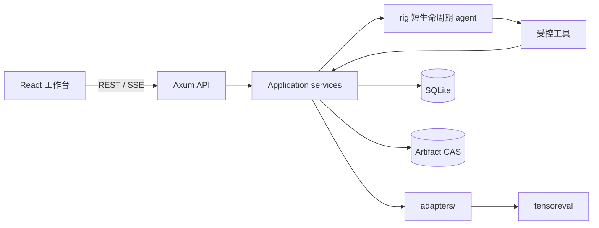

# 配电网仿真智能体 V3 架构

> 状态：V3 实施中。部署和重置说明见 [v3-deployment.md](v3-deployment.md)，HTTP 线格式见
> [api-design.md](api-design.md)，数据库见 [db-design.md](db-design.md)，全链路验收设计见
> [integration-testing-design.md](integration-testing-design.md)。

## 1. 系统边界

系统由 React/TypeScript 前端、Rust/Axum 后端、SQLite、内容寻址 artifact 存储、LLM 和
`tensoreval` 组成。自然语言是领域写操作的主入口；上传、历史浏览、案例浏览、表格分页和下载使用
固定控件。

仿真内核调用只能位于 `backend/src/adapters/`。工具只接收资源 ID 和结构化参数，不能接收服务器
路径、任意命令、SQL 或 ECharts option。

## 2. 身份和并发

- 空库启动从内置 `init_users.csv` 原子初始化固定用户，每个用户获得唯一 storage scope；CSV 内容 hash
  固化在数据库，CSV 改动要求重置数据库和 DATA_DIR。
- 用户以 ID 和密码登录；当前版本初始密码与 ID 相同。服务端在 SQLite 中保存 Argon2id 散列和不透明
  登录 token 的 SHA-256，浏览器只持有 HttpOnly Cookie。
- 用户所有权约束 session、消息、版本、任务、数据集、SSE 和历史搜索；猜测其他用户的 ID 与不存在 ID
  都返回 404。
- 登录可跨浏览器独立存在；退出只撤销当前 Cookie，并立即结束对应 SSE。公网 HTTPS 必须使用 Secure Cookie。
- 每条用户消息创建一次短生命周期 agent run。会话连续性来自 SQLite，不为用户常驻 agent。
- 同一 session 串行，owner 最多 2 个活动 run，实例最多 8 个，等待队列最多 32；第 33 个等待项返回
  `429 agent_queue_full` 且不写用户消息。
- 引擎子进程由独立 semaphore 限制为 4 个并发，并由 Tokio 异步等待。

## 3. 持久领域链

`Artifact → Ingestion → ModelVersion → SimulationTask → ResultDataset → ResultAnalysisRun/Comparison`

- artifact 以 SHA-256 内容寻址，数据库只保存相对路径。
- 一个 session 对应一个 workspace；active 用于默认运行，draft 保存新上传或修改后的候选版本。
- 模型版本、版本输入、结果数据集和分析脚本发布后不可变。错传、替换、移除和参数修改都创建子版本。
- 任务固定绑定 model version、study spec、实际 RSS 脚本、agent bundle/skills 和 engine contract。
- 仿真与分析均显式调用 `--result-dir ... --output-format parquet`，成功输出经校验和配额事务后发布。
- 数据库不预设电压、损耗等统计值。用户问题由 agent 生成受控 RSS 分析脚本，输入已有 Parquet，
  输出新的 Parquet DataFrame。

## 4. 引擎知识和案例

非测试启动必须提供 `TENSOREVAL_CWD`。启动阶段校验：

1. tensoreval capability 与当前命令合同；
2. `sparrowzz/dss/docs` 文档和 catalog hash；
3. 根 RSS、rssbundle 案例及依赖 hash；
4. 嵌入式 agent manifest、system prompt、skill hash 和合同兼容关系。

通过后把只读资源发布为 hash 标识的 snapshot。运行期按稳定文档 section/example ID 读取，不直接依赖
变化中的源目录。导入案例会复制完整依赖到当前用户 storage scope；后续修改不会写回共享案例。

开发环境可以用受控的 `eig-rs` 工作树作为 `TENSOREVAL_CWD`。候选发布必须把合同范围内的资源和
跨目录案例依赖打成固定 artifact，并记录 binary SHA-256；服务不把任意相邻源码目录当成发布事实。
manifest 中的 commit/dirty 信息用于审计来源，启动判定以 capability 和固定内容 hash 为准。

## 5. 消息与恢复

用户 POST 消息后立即得到 202。持久事件先提交 SQLite，再发布 SSE；SSE 帧使用 message ID，支持
`Last-Event-ID` 补发，游标不可用时发送 `resync-required`。前端先建立 SSE，再读取最近消息页，并
按 ID、operation、callId、batch/file 和 producer/dataset 归并。

历史消息默认最近 50 条，可用 `beforeId` 或 `aroundId` 分页。三字符及以上的历史搜索使用 FTS5
trigram，一至二字符使用转义且有界的 LIKE。FTS 故障只影响搜索，普通历史读取保持可用。

## 6. 前端工作台

- 左侧：按用户恢复上次会话、历史搜索、重命名和删除，底部显示用户菜单。
- 中间：八类持久消息、自然语言输入、多文件/目录上传和上传队列。
- 右侧：active/draft 工作区、推断证据、缺失输入、摄取状态和任务历史。
- 结果层：每张 DataFrame 都有 cursor 分页表格和 Parquet 下载；保存的视图支持折线、柱状、散点、
  热力、箱线和直方图。

模型只生成 `VisualizationSpec`。前端白名单 builder 生成 ECharts option，不执行 formatter 字符串。
数据区域独立处理错误，图表超限时提示用户在对话中要求筛选或聚合。

## 7. 存储和发布

每个用户计费 scope 默认 20,000 个唯一 artifact、20 GiB、80% 告警，不按天自动删除。硬限制只阻止新
artifact，历史读取和下载仍可用。删除会话后由 GC 在引用归零时释放空间。

V3 只支持全新数据库和 DATA_DIR。仓库包含一份 initial migration，不提供旧原型 schema、CSV 结果、
固定 metrics、`/curves`、`/report` 或运行时回退。

## 8. 自动化验收边界

PR 门禁使用 Playwright 驱动真实前端和 Axum 服务，后端使用临时 SQLite/CAS；LLM 和仿真进程通过依赖
注入替换为可编排实现，但请求仍经过生产调度器、Agent 工具、application service 和 adapter 边界。
候选发布再使用真实 DeepSeek 和当前 engine contract 的 tensoreval 验证外部依赖。

功能覆盖率按机器可读功能目录计算。每个设计功能都必须关联自动化测试和业务断言，公开端点、消息、工具、
skill、输入格式和视图 manifest 与目录双向校验。详细矩阵、故障注入和发布规则以
[integration-testing-design.md](integration-testing-design.md) 为准。
