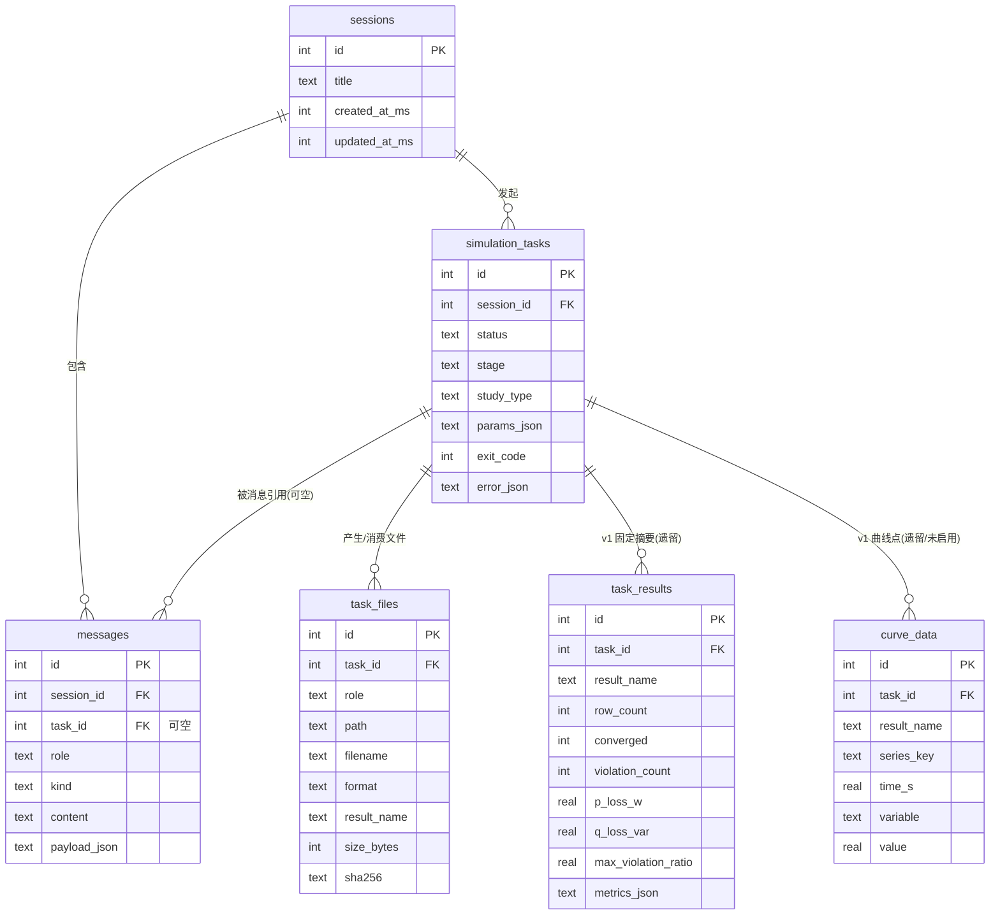
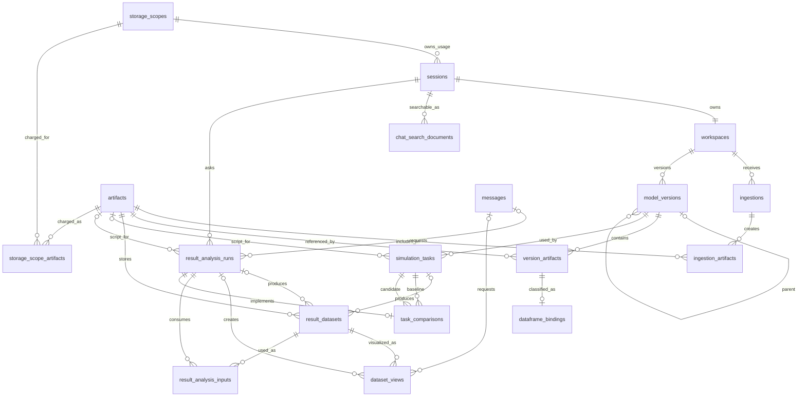

# 数据库层设计（SQLite + Diesel）

> 版本：v1 原型基线 + v2 干净 schema 目标
> 配套迁移：`backend/migrations/00000000000000_initial/`、
> `backend/migrations/00000000000001_task_latest_status/`
> 说明：本文只描述设计，不包含任何 Rust 业务代码。引擎结论以 `../eig-rs/sparrowzz/dss/docs/` 为准，与 `AGENTS.md` 冲突处已在 §0.4 标注。
> §1–§6 描述 v1 schema 基线；6 张表和 Rust models 已实现，但任务产物元数据写入尚未全部接线。
> §7 是模型工作区、历史检索与对比的 v2 目标 schema。v1 未投入使用，v2 从空库初始化，不做数据
> 回填或双读。完整语义见
> `docs/model-workspace-design.md`。

---

## 0. 前提：仿真引擎的真实形态（本设计的依据）

先厘清引擎“实际上是什么”，DB 设计才有根据。以下来自只读调研
`../eig-rs/sparrowzz/dss/docs/`（README、agent_quickstart、simulation_recipes、
dataframe_schema_reference、validation_and_troubleshooting、catalog/*）。

### 0.1 输入形态：不是“模型路径 + 一个参数对象”，而是「模型 + 脚本 + 可选数据文件」

- 输入的主载体是一段 **RSS 脚本**（`.rss`，RustScriptSimulation），由 agent 生成。脚本里
  `import_dss("path/model.dss")` 导入静态模型，随后构造研究表（`solution`、`load_shape`、
  `shape_assignment` 等）和参数表 `para`，再调用 DSA 函数（`ds_radial_pf`、`ds_radial_qsts`
  等）。
- 模型是一个 **`.dss` 入口文件**，可通过 `Redirect`/`#include` 引用更多文件（可能是一个
  文件树）。对应地，引擎提供 `.rssbundle` **目录**，把入口和被引用文件组织为自包含文件树。
- 外部数据（负荷时序、PV 曲线、储能 profile 等）通过 `#include`/`#include_url` 读脚本文本，
  或通过 `--input NAME=FILE` 注入 CSV/XLSX/Parquet 表，再由 RSS 输入函数读取。
- **结论**：`simulation_tasks.params_json` 存的是「agent 友好的紧凑快照」（模型路径、分析
  类型、`result` 选择、QSTS 时间设置、外部数据引用），完整 `.rss` 脚本作为文件存
  `task_files`（`role='script'`），而不是塞进 params JSON。

### 0.2 输出形态：同步返回命名 DataFrame（表），可逐表落成 CSV/Parquet

- `tensoreval --df case.rss` 是**同步 CLI**：进程退出码 0 表示成功，非 0 表示失败。
- 输出是一组**命名结果表**（named DataFrames），由 `para.result` 决定请求哪些、按什么顺序
  返回。常用：`bus_phase`/`bus_voltage`（电压）、`branch_flow`（线路/变压器功率与损耗）、
  `source_flow`、`load_state`、`storage_state`、`energy_meter`、`meter_loss_breakdown`、
  `summary`（收敛/迭代/总损耗/越限数）、`violations`、`execution_trace`/`diagnostics`/`events`
  （仅执行计划类入口产出）。
- **可直接落文件**：`tensoreval --df --result-dir DIR --output-format parquet case.rss` 会把每个命名
  结果直接写成 Snappy 压缩的 `DIR/结果名.parquet`；不传 `--output-format` 时仍默认 CSV。
  这是「结果 DataFrame 存文件」策略的自然集成点。
- **版本合同以源码和启动探测为准**：eig-rs 当前源码已提供
  `--output-format <csv|parquet>`，但项目 `.env` 当前指向的已编译二进制仍需重编译/替换后复验该参数。
  v1 真实 QSTS 已通过默认 CSV 路径运行。上游
  `rss_language_reference.md` §8.3 中“没有输出文件参数”的描述滞后，本项目不采用该句；适配器启动时
  应校验目标二进制仍声明该参数，避免二进制与文档版本漂移。
- 关键列已确认（单位 V/A/W/var/VA/ohm，角度 rad，谐波角度 degree）：
  - `summary`: `converged, p_loss, q_loss, violation_count, max_violation_ratio, ...`
  - `violations`: `kind, element, bus, phase, value, limit, ratio`
  - `bus_phase`: `bus, phase, v_re, v_im, v_mag, v_ang`
  - `branch_flow`: 支路电流/功率/损耗 + 绕组 tap（30 列左右，含 `p_loss, q_loss`）
  - QSTS 结果额外追加 `time, load_multiplier, generation_multiplier`

### 0.3 任务生命周期：引擎无状态/无进度，生命周期由后端编排

- 执行是**同步、进程级单线程**：`tensoreval` 入口是普通 `fn main()`（无 `#[tokio::main]`），
  全程无 `.await` / `thread::spawn` / `rayon::par_*`；一次进程 = 一次 case，跑完即退出，
  求解期间阻塞发起方。
- 限定：`mems` crate 依赖里虽有 `rayon` 与可选 `tokio`，但那是给 Web 服务主程序
  （`tools` feature）用的，CLI 不启动 tokio 运行时；polars 内部可能做数据级并行，属库
  实现细节、不可依赖。
- 引擎**没有** task_id、异步进度、阶段状态机的概念。它要么一次跑完（退出码 0 + 结果表），
  要么失败（退出码非 0 + `diagnostics`/`events` 或解析错误）。`summary.converged` 是收敛的
  唯一权威信号。
- “模型检查”对应脚本里 `import_dss(...)` 的解析步骤：fail-closed，有诊断就整体失败。
- **结论**：`simulation_tasks` 的 `status/stage/created/started/finished` 是**后端强加的
  编排抽象**，不是引擎概念。`status` 状态机为
  `pending → running → succeeded | failed | cancelled`；`stage` 只记录
  `model_check | script_gen | running | collecting`。当前 QSTS 跳过预留的 `script_gen`。

### 0.4 与 AGENTS.md 的冲突点（引擎为准）

| 项 | AGENTS.md 描述 | 引擎实际 | 本设计取 |
|---|---|---|---|
| 调用形态 | 适配器返回 `async`，`reqwest` 访问内核服务 | 同步 CLI `tensoreval`，无 HTTP 服务 | 引擎为准：适配器用 `tokio::process::Command` 启动并异步等待子进程 |
| `run_simulation` 返回值 | `task_id`（异步任务 ID） | 无 task_id，同步返回结果表 | `task_id` = 本系统 `simulation_tasks.id`（后端生成），与引擎无关 |
| `inspect_model` 返回值 | 硬编码 `"model ok"` | `import_dss` 解析（fail-closed + 诊断） | 模型检查 = 脚本 import 步骤，结果落在 task 的 stage/error_json |
| 错误码 | 适配器翻译内核错误码 | 稳定 `category/code` + 诊断 message | 保留：错误码翻译仍在适配器，`error_json` 存结构化诊断 |

> 对 DB 设计本身影响不大，但必须写清楚：不要把 `task_id`、异步进度误当成引擎能力。

### 0.5 并发与限流：同步阻塞带来的编排约束

- 引擎是**同步批处理**而非常驻服务：求解为 CPU 密集的阻塞计算，一个进程同一时刻只算一个
  case。
- 后端并发跑仿真必须**排队/限流**（信号量或任务队列，例如同时最多 N 个引擎子进程），否则
  多个子进程抢占 CPU 核，反而变慢。
- 这也是「曲线存文件、DB 只存元数据」的同一推理起点：把一次性的同步计算包装成有状态、
  可追溯的异步任务，责任在后端编排层，不在引擎。

---

## 1. 实体关系图



关系说明（文字）：

- `sessions 1—N messages`：一个会话包含多条消息。
- `sessions 1—N simulation_tasks`：一个会话发起多个仿真任务。
- `simulation_tasks 1—N messages`（可空）：一条“工具调用卡片 / 结果卡片”消息可以指向某个任务；
  一条消息最多关联一个任务，一个任务可被多条消息引用。删除任务**不**删除消息（`SET NULL`）。
- `simulation_tasks 1—N task_files / task_results / curve_data`：这是已实现的 v1 schema；其中
  `task_results/curve_data` 不再作为 v2 结果模型。删除任务级联删除元数据，文件本体由存储层清理。

### 为什么 `messages` 和 `simulation_tasks` 要分开

1. **生命周期不同**：消息是 append-only 的对话记录，一旦写入基本不变；任务有独立状态机
   （`pending → running → succeeded/failed`）和多个时间戳，会随进度反复更新。塞进消息 JSON 会导致
   每次状态变更都要改写整条消息，且无法高效 `WHERE status='running'` 轮询。
2. **引用完整性**：v1 的 `task_files/task_results/curve_data` 都外键到 `simulation_tasks.id`；v2 的
   `result_datasets/result_analysis_runs` 也需要独立外键。若任务内嵌在
   消息 JSON 里，这些外键就变成“JSON 里的引用”，SQLite 无法约束、无法索引。
3. **多对多/多对一**：一条消息引用一个任务，一个任务可被多条消息引用（如“运行卡片”+“结果卡片”）。
   这天然是一张独立表的关系，不是消息 JSON 的字段。
4. **体量与关注点分离**：结果/曲线是批量数据，有自己的存储策略（文件）；消息是聊天文本。内联会
   让 messages 表膨胀并污染其单一职责。

---

## 2. 表结构设计

### 通用约定

- **主键**：一律 `INTEGER PRIMARY KEY AUTOINCREMENT`；当前 Diesel schema 映射为 `i32`，时间戳和
  文件字节数使用 `i64`。
- **时间戳**：一律 `INTEGER`（Unix 纪元，**毫秒**），列名后缀 `_ms`。
  - 理由：子消息/工具调用可能在同一秒内连发，需要亚秒精度排序；INTEGER 天然可比较、可建索引、
    无时区/格式歧义；Diesel 直接映射 `i64`，无需 `chrono` 特性。
  - 代价：不如 ISO8601 TEXT 可读，读库调试时需转换；可接受，展示层负责格式化。
  - 消息内排序用 `(session_id, id)` 兜底（`id` 单调递增），避免 ms 相撞。
- **布尔**：用 `INTEGER`（0/1），Diesel 映射 Rust `bool`（SQLite 无 BOOLEAN）。
- **JSON 边界**：所有 JSON 一律存 `TEXT`（SQLite 无 JSONB）。规则见 §2.6。

### 2.1 sessions

| 列 | 类型 | 约束 | 说明 |
|---|---|---|---|
| `id` | INTEGER | PK AUTOINCREMENT | |
| `title` | TEXT | NOT NULL DEFAULT '' | v1 由创建请求给出并可手动改名；v2 自动标题见 §7.10 |
| `created_at_ms` | INTEGER | NOT NULL | |
| `updated_at_ms` | INTEGER | NOT NULL | 每次新消息/新任务时刷新，用于历史列表按最近排序 |

索引：`idx_sessions_updated ON sessions(updated_at_ms)`（历史列表排序）。

### 2.2 simulation_tasks

| 列 | 类型 | 约束 | 说明 |
|---|---|---|---|
| `id` | INTEGER | PK AUTOINCREMENT | 即对外暴露的 `task_id` |
| `session_id` | INTEGER | NOT NULL FK→sessions, CASCADE | |
| `status` | TEXT | NOT NULL | `pending/running/succeeded/failed/cancelled` |
| `stage` | TEXT | NULL | 后端编排阶段：`model_check/script_gen/running/collecting` |
| `study_type` | TEXT | NULL | 开放字符串筛选标签；规范已知别名（如旧 `fault`→`short_circuit`），不限制内核新增分析类型 |
| `params_json` | TEXT | NOT NULL | 参数快照（模型路径、study_type、result 选择、QSTS 时间设置、外部数据引用） |
| `exit_code` | INTEGER | NULL | 引擎退出码 |
| `error_json` | TEXT | NULL | 结构化错误/诊断（`diagnostics`/`events` 或适配器错误） |
| `created_at_ms` | INTEGER | NOT NULL | |
| `started_at_ms` | INTEGER | NULL | |
| `finished_at_ms` | INTEGER | NULL | |

当前 `run_simulation` 创建的 QSTS 任务尚未填写 `study_type`，实际为 NULL；v2 新 schema 将其改为
非空规范标签，QSTS 写 `qsts`，不回填原型任务。

索引：
- `idx_tasks_session_time ON simulation_tasks(session_id, created_at_ms)`（会话内任务时间线）
- `idx_tasks_status ON simulation_tasks(status)`（轮询/清理运行中任务）

### 2.3 messages

| 列 | 类型 | 约束 | 说明 |
|---|---|---|---|
| `id` | INTEGER | PK AUTOINCREMENT | |
| `session_id` | INTEGER | NOT NULL FK→sessions, CASCADE | |
| `task_id` | INTEGER | NULL FK→simulation_tasks, SET NULL | 卡片消息关联的任务 |
| `role` | TEXT | NOT NULL | `user/assistant/tool` |
| `kind` | TEXT | NOT NULL | v1 实际值：`text/tool-call/progress/result/attachment` |
| `content` | TEXT | NOT NULL DEFAULT '' | 纯文本（用户消息、助手文本、卡片的一句话摘要） |
| `payload_json` | TEXT | NULL | 卡片结构化数据（工具参数、结果摘要） |
| `created_at_ms` | INTEGER | NOT NULL | |

索引：
- `idx_messages_session_time ON messages(session_id, created_at_ms)`（会话内时间线）
- `idx_messages_task ON messages(task_id)`（反查某任务关联的消息）

> `content` 与 `payload_json` 的分工：文本类消息用 `content`；卡片类消息 `content` 存一行可读摘要，
> `payload_json` 存机器可读结构。避免“一列既放纯文本又放 JSON”的歧义。

### 2.4 task_files（v1 已建表但写入未接线的任务文件元数据）

| 列 | 类型 | 约束 | 说明 |
|---|---|---|---|
| `id` | INTEGER | PK AUTOINCREMENT | |
| `task_id` | INTEGER | NOT NULL FK→simulation_tasks, CASCADE | |
| `role` | TEXT | NOT NULL | `input_model/input_data/script/output_curve/report/diagnostics` |
| `path` | TEXT | NOT NULL | 相对 `DATA_DIR` 的路径（DB 可整体迁移） |
| `filename` | TEXT | NOT NULL | 原始/展示文件名 |
| `format` | TEXT | NULL | `dss/csv/parquet/rss/json` |
| `result_name` | TEXT | NULL | `output_curve` 对应的结果名（`bus_phase/branch_flow/...`） |
| `size_bytes` | INTEGER | NULL | |
| `sha256` | TEXT | NULL | 内容哈希（去重、完整性、bundle 校验对齐） |
| `created_at_ms` | INTEGER | NOT NULL | |

索引：
- `idx_files_task_role ON task_files(task_id, role)`
- `idx_files_sha256 ON task_files(sha256)`（可选，供去重）

### 2.5 task_results（v1 已建表但写入未接线，v2 停用）

该表是初版围绕 QSTS 卡片预设的摘要结构，实际 migration 和 Diesel model 已存在，但当前写入链路
尚未接通。它只能准确描述少数已知结果，不能表达用户将来通过任意 RSS 脚本产生的 DataFrame。

| 列 | 类型 | 约束 | 说明 |
|---|---|---|---|
| `id` | INTEGER | PK AUTOINCREMENT | |
| `task_id` | INTEGER | NOT NULL FK→simulation_tasks, CASCADE | |
| `result_name` | TEXT | NOT NULL | `summary/violations/bus_phase/branch_flow/...` |
| `row_count` | INTEGER | NOT NULL DEFAULT 0 | 结果行数 |
| `converged` | INTEGER | NULL | 0/1，仅 `summary` 填 |
| `violation_count` | INTEGER | NULL | 仅 `summary` 填 |
| `p_loss_w` | REAL | NULL | 总网损 W，仅 `summary` 填 |
| `q_loss_var` | REAL | NULL | 总网损 var，仅 `summary` 填 |
| `max_violation_ratio` | REAL | NULL | 最大越限比，仅 `summary` 填 |
| `metrics_json` | TEXT | NOT NULL | 完整摘要：`summary`→全量指标；`violations`→越限列表；曲线→`{n_times,n_series,columns}` 摘要 |
| `created_at_ms` | INTEGER | NOT NULL | |

索引：
- `idx_results_task_name UNIQUE (task_id, result_name)`（每个任务每类结果一行）
- `idx_results_task ON task_results(task_id)`

`converged/violation_count/p_loss_w/q_loss_var/max_violation_ratio` 都是假设具体分析类型后才有意义的
领域统计值。v2 schema 直接删除该表，不把 `metrics_json` 扩成新的万能 JSON。§7.8 的
`result_datasets` 保存 DataFrame 文件及中立 schema 元数据，具体统计由用户提出问题后生成 RSS
分析脚本计算。

### 2.6 curve_data（v1 遗留，v2 不启用）

该表已存在但没有写入链路。v2 不把任意 DataFrame 强制拆成 `series_key/time_s/variable/value`，因为
并非所有分析都具有时间轴或单一数值列。v2 分页表格从 `result_datasets` 指向的 Parquet 按需读取，
多个图表由 `dataset_views` 映射同一文件；需要筛选、聚合、降采样或转成长表时，由 RSS 分析脚本生成
新的派生 DataFrame 文件。

| 列 | 类型 | 约束 | 说明 |
|---|---|---|---|
| `id` | INTEGER | PK AUTOINCREMENT | |
| `task_id` | INTEGER | NOT NULL FK→simulation_tasks, CASCADE | |
| `result_name` | TEXT | NOT NULL | |
| `series_key` | TEXT | NOT NULL | 设备/母线/相标识（如 `bus.phase` 或 `element.terminal.phase`） |
| `time_s` | REAL | NOT NULL | 仿真时间（秒），QSTS 的 `time` |
| `variable` | TEXT | NOT NULL | `v_mag/p/q/i_mag/...` |
| `value` | REAL | NOT NULL | |

索引：`idx_curve_task_name_key_time ON curve_data(task_id, result_name, series_key, time_s)`。

### 2.7 JSON 字段边界总结

**适合 TEXT 存 JSON（整体读写，不参与 WHERE/JOIN/排序）**：
- `simulation_tasks.params_json`、`simulation_tasks.error_json`
- `messages.payload_json`（工具参数、结果卡片结构）

**必须拆独立列（要查询/排序/外键）**：
- 主键/外键（`id`、`session_id`、`task_id`）
- 任务状态与阶段（`status`、`stage`）
- 时间戳（`*_ms`）
- 消息 `role`/`kind`（过滤维度）

**原则**：SQLite 的 JSON 只是 TEXT，`json_extract()` 可用但不走索引；凡稳定的系统热路径（状态、
归属、血缘、时间、分页）必须独立成列。仿真领域统计不是稳定系统字段，不为“可能以后会问”预设列；
由 RSS 脚本输出新的 DataFrame，再通过结果数据集元数据登记。

---

## 3. Diesel 集成要点

### 3.1 Cargo.toml feature

```toml
diesel = { version = "2.3", features = ["sqlite", "r2d2"] }
diesel_migrations = "2.3"
```

- `sqlite`：`diesel::sqlite::SqliteConnection`。
- `r2d2`：`diesel::r2d2::ConnectionManager<SqliteConnection>` 连接池（服务器必需）。
- `chrono`：**不需要**。时间戳用 `i64` 毫秒，避免引入时间类型与 UTC 转换复杂度。

### 3.2 SQLite PRAGMA（每次建连后执行）

SQLite 默认：外键 OFF、无锁等待、journal 模式为 delete。服务器并发下必须逐连接设置：

```sql
PRAGMA foreign_keys = ON;      -- 外键约束（Diesel 不会自动开）
PRAGMA journal_mode = WAL;     -- 读写并发：一写多读
PRAGMA busy_timeout = 5000;    -- 锁等待 5s，而不是立即 SQLITE_BUSY
PRAGMA synchronous = NORMAL;   -- WAL + NORMAL 的性能/持久性平衡
```

- **时机**：`foreign_keys/busy_timeout/synchronous` 是**每连接**属性，必须在每个新连接上执行；
  `journal_mode=WAL` 是库文件级属性，设置一次即持久，但建连时再设一次幂等无副作用。
- **实现**：用 r2d2 的 `Builder::connection_customizer(Box::new(MyPragmaCustomizer))` 在每个连接
  初始化时跑上述 PRAGMA，或自定义 `establish()` 函数。不要只在启动时设一次。

### 3.3 异步：`tokio::task::spawn_blocking`

Diesel 是同步阻塞库。Axum 处理器是异步的，**不能直接在 async 上下文里调 Diesel**，否则阻塞
事件循环。做法：

```rust
use diesel::r2d2::{Pool, ConnectionManager};
use diesel::sqlite::SqliteConnection;

type DbPool = Pool<ConnectionManager<SqliteConnection>>;

async fn list_messages(state: axum::extract::State<DbPool>, ...) -> Result<..., ...> {
    let pool = state.clone();
    let rows = tokio::task::spawn_blocking(move || -> Result<Vec<Message>, diesel::result::Error> {
        use crate::schema::messages::dsl::*;
        let mut conn = pool.get()?;      // 阻塞闭包内部从池取连接
        messages.filter(session_id.eq(sid)).load::<Message>(&mut conn)
    })
    .await                       // 等待 JoinHandle
    .map_err(...)?               // spawn_blocking 的 panic/取消
    ?;                           // Diesel 错误
    Ok(rows)
}
```

要点：池用 `Arc`/`State` 共享；`pool.get()` 与所有 Diesel 调用都在阻塞闭包内执行，跑在 blocking
线程池上，不占 async worker。

### 3.4 迁移管理：手写 SQL + 目录结构

- **推荐手写 SQL**（不用 `diesel migration generate` + schema diff）：本设计一次定稿、字段明确，
  手写能精确控制 SQLite DDL（类型、索引、外键、注释），避免 diesel 自动生成的不必要差异。
- 目录（Diesel 约定，位于 crate 根 `backend/` 下）：

  ```text
  backend/migrations/
    ├── 00000000000000_initial/
    │   ├── up.sql
    │   └── down.sql
    └── 00000000000001_task_latest_status/
        ├── up.sql
        └── down.sql
  ```

- **当前执行方式**：`db/mod.rs` 用 `diesel_migrations::embed_migrations!()` 编译期嵌入，进程启动时
  `run_pending_migrations()` 自动升级；开发者也可使用 Diesel CLI 检查迁移。

---

## 4. v1 迁移（已实现）

见 `backend/migrations/00000000000000_initial/up.sql` 与 `down.sql`。

要点：建表顺序按依赖（父先于子）；所有时间戳 INTEGER 毫秒；外键 `ON DELETE CASCADE` / `SET NULL`
按 §1 约定；`curve_data` 保留但标注为可选。

---

## 5. 容量估算与结果 DataFrame 存储策略

### 5.1 容量估算

基准案例：**24h / 15min 步长 = 96 时间点，50 节点 × 3 相 = 150 个 (bus, phase) 键**。

| 结果 | 行数 | 列 | CSV 体积（估） | Parquet 体积（估） |
|---|---|---:|---:|---:|
| `bus_phase`（电压） | 96 × 150 = 14,400 | 6 | ~0.9 MB | ~0.15 MB |
| `branch_flow`（支路） | 96 × ~70 支路 ≈ 6,700 | ~30 | ~1.5–2 MB | ~0.3 MB |
| `summary/violations/load_state/...` | 很小 | — | <100 KB | — |
| **单个 QSTS 任务合计** | | | **~3 MB** | **~0.5 MB** |

- 若曲线存 SQLite `curve_data` 长表：`bus_phase` 4 个数值 × 14,400 = **57,600 行**，且每行冗余
  `series_key` 文本 + 行开销，约 **8–12 MB**（CSV 的 3–4 倍、Parquet 的 ~50 倍），查询回放还需
  把数万行按 key/time 重组为数组。
- 100 个任务：文件方案 ~300 MB CSV / ~50 MB Parquet；SQLite 方案 ~1 GB+，备份/VACUUM/清理都更重。

### 5.2 结论：所有结果 DataFrame 存文件，DB 只存目录、schema 与血缘

**目标设计**：
- v2 原始仿真和后续结果分析都由适配器显式调用
  `tensoreval --df --result-dir DIR --output-format parquet`，每个命名 DataFrame
  由引擎直接写为独立 Parquet 文件；后端不做 CSV→Parquet 二次转换，只计算内容哈希并登记为不可变 artifact。
- DB 不保存预设的收敛、网损、电压、越限等领域统计。`result_datasets` 只保存文件引用、结果名、
  行数、列名/dtype/单位、生产者和输入血缘；这些信息与仿真类型无关。
- 用户询问“最大电压在哪里”“按小时统计损耗”“比较修改前后”等问题时，agent 先读取可用数据集的
  schema，再生成 RSS 脚本；应用层把可信 dataset ID 映射为 `--input NAME=FILE`，适配器执行并把
  新 DataFrame 继续登记为派生数据集。
- 分页表格是每张 DataFrame 的通用入口，图表是由 `dataset_views` 声明的多个语义视图。小结果可以
  内联预览，大结果通过分页表格或具体 view 数据端点读取；若现有表不适合展示，agent 生成筛选、
  聚合或降采样后的新表。
- 格式：`result_datasets` 统一使用 Snappy Parquet；v2 不保存 CSV 结果 artifact。
- 存储根：约定 `DATA_DIR`（env），子目录 `models/ uploads/ scripts/ outputs/ reports/`；
  `artifacts.storage_path` 存**相对路径**，保证 DB 可整体搬迁。

**为什么不存 SQLite**：
1. DataFrame 是批量表数据，通常按文件扫描、分页或经 RSS 再分析，不需要先拆成 SQL 领域指标和曲线点。
2. 行式存储体积大 3–50 倍，且回放要重组成数组，慢。
3. 文件方案让备份/清理/去重（sha256）都更简单，且与引擎 `--result-dir` 直接对接。

`curve_data` 和 `task_results` 不进入 v2 schema。跨任务统计检索若成为明确产品需求，应建立独立
索引/物化视图；不能反过来把所有可能的领域指标塞进主结果表。

---

## 6. 已确认配置与后续

- [x] 数据根使用 `DATA_DIR`；未设置时取进程工作目录下的 `data/`。按文档从 `backend/` 启动即为
      `backend/data/`，该目录已加入 `.gitignore`。
- [ ] v2 建立 `artifacts/result_datasets/dataset_views/result_analysis_runs/result_analysis_inputs` repository 与写入
      链路；适配器固定传 `--output-format parquet`。
- [ ] 删除 `task_results/curve_data`、固定 metrics payload 和旧曲线读取代码。
- [ ] 为结果分析提供受控脚本执行：只接受 dataset ID，禁止 LLM 传路径；保存脚本 artifact、输入
      alias、输出 DataFrame 和诊断。
- [ ] 文件本体删除策略：`ON DELETE CASCADE` 只删元数据行，磁盘文件由存储层定期清理或任务级清理。
- [x] 当前原型适配器以 `--result-dir` 的命名 CSV 为合同；v2 实现时直接删除这条代码路径。
- [ ] 重编译/替换 `.env` 指向的 tensoreval，启动时探测 `--output-format`，并用真实任务验证
      `--output-format parquet` 生成可读取的 Snappy Parquet；未通过时禁止启用 v2 任务。
- [ ] zjudss 结果服务层增加显式 Parquet 读取依赖，提供 schema/行数校验、分页、列投影和有界 JSON
      转换；这与 tensoreval 已支持 Parquet `--input` 是两个边界。禁止依赖其他 crate 的传递依赖，也
      不能为读取方便把完整 Parquet 转成临时 CSV。

---

## 7. v2 目标 schema：身份、工作区、结果分析与比较（尚未实现）

v2 发布前将开发期增量 migration 压成一份新的 initial schema，部署时删除原型数据库和 DATA_DIR 后
从空库初始化。schema 不包含 `task_results`、`curve_data` 或可空归属字段。

`sessions` 除 §2.1 的基础字段外，增加非空 `access_scope_kind`、`access_scope_key` 和
`storage_scope_id`。前两列用于授权，后一列用于配额；三者只能由认证 extractor 解析当前主体后写入，
客户端不得提交。`AUTH_MODE=instance` 使用固定 instance scope；`AUTH_MODE=trusted_proxy` 使用认证
代理提供的 owner/tenant subject。所有子资源通过 session 关系校验 scope，跨 scope 统一返回 404。

### 7.1 新关系



### 7.2 workspaces

| 列 | 类型 | 约束 | 说明 |
|---|---|---|---|
| `id` | INTEGER | PK AUTOINCREMENT | |
| `session_id` | INTEGER | NOT NULL UNIQUE FK→sessions, CASCADE | 一个会话一个工作区 |
| `active_version_id` | INTEGER | NULL FK→model_versions, SET NULL | 默认仿真使用的 ready 版本；初始 schema 可先声明引用、后创建目标表 |
| `draft_version_id` | INTEGER | NULL FK→model_versions, SET NULL | 新上传、待确认或校验失败的候选版本 |
| `created_at_ms` | INTEGER | NOT NULL | |
| `updated_at_ms` | INTEGER | NOT NULL | |

### 7.3 ingestions 与 ingestion_artifacts

`ingestions` 保存上传或内置案例导入批次及幂等键：

| 列 | 类型 | 约束 | 说明 |
|---|---|---|---|
| `id` | INTEGER | PK AUTOINCREMENT | 也是摄取 progress 的操作 ID |
| `workspace_id` | INTEGER | NOT NULL FK→workspaces, CASCADE | |
| `base_version_id` | INTEGER | NULL FK→model_versions, SET NULL | 上传时看到的 draft；无 draft 时为 active |
| `client_batch_id` | TEXT | NOT NULL | 客户端重试幂等键 |
| `origin_kind` | TEXT | NOT NULL | `upload/example`；由服务端确定 |
| `source_ref_json` | TEXT | NULL | example 时保存 example ID、resource snapshot、tree hash 和来源；upload 为 NULL |
| `status` | TEXT | NOT NULL | `accepted/extracting/inferring/validating/succeeded/completed_with_errors/failed` |
| `error_json` | TEXT | NULL | 结构化错误 |
| `created_at_ms` | INTEGER | NOT NULL | |
| `updated_at_ms` | INTEGER | NOT NULL | 工作区摘要和乱序事件合并依据 |
| `finished_at_ms` | INTEGER | NULL | |

唯一约束：`UNIQUE(workspace_id, client_batch_id)`。
案例导入的 `client_batch_id` 由服务端按 `example ID + snapshot + workspace + base version` 生成，重试同一
导入保持幂等；`source_ref_json` 不接受客户端或 LLM 提交的路径。

`ingestion_artifacts` 连接批次与原始/解包/Excel 拆表后的 artifact：

| 列 | 类型 | 约束 | 说明 |
|---|---|---|---|
| `id` | INTEGER | PK AUTOINCREMENT | 同批次相同内容的两个原始文件仍是两个上传项 |
| `ingestion_id` | INTEGER | NOT NULL FK→ingestions, CASCADE | |
| `artifact_id` | INTEGER | NOT NULL FK→artifacts, RESTRICT | 内容可去重，因此不能与 ingestion_id 组成主键 |
| `role` | TEXT | NOT NULL | `uploaded/example/extracted/normalized` |
| `client_file_id` | TEXT | NULL | 仅 uploaded 填写；批次内稳定客户端文件 ID，用于乱序关联和幂等重试 |
| `client_filename` | TEXT | NOT NULL | 用户上传名或案例内安全相对路径的展示名 |
| `source_artifact_id` | INTEGER | NULL FK→artifacts, RESTRICT | extracted/normalized 指向来源 ZIP/Excel 等 artifact |
| `status` | TEXT | NOT NULL | `accepted/processing/ready/failed`；uploaded 行对外，派生行用于诊断 |
| `error_json` | TEXT | NULL | 当前项经过筛选的结构化错误；成功项为 NULL |

唯一约束补充：建立部分唯一索引
`UNIQUE(ingestion_id, client_file_id) WHERE role='uploaded' AND client_file_id IS NOT NULL`。
一个 ZIP 或多工作表 Excel 可以派生多条 extracted/normalized 记录，它们通过 `source_artifact_id`
追溯原上传文件，不复用会造成唯一键冲突的 clientFileId。
幂等重试命中已有 clientFileId 后必须比较 artifact 内容哈希；不一致返回 `idempotency_conflict`，不能
原地替换该行的 artifact。修正后的新文件使用新的 batch/file ID。

所有 uploaded 项为 `ready` 时批次记为 `succeeded`；ready 与 failed 并存时记为
`completed_with_errors`，并只用成功项发布候选版本；批次级致命错误或没有可用项时记为 `failed`。
`succeeded/completed_with_errors/failed` 是当前尝试的终态，不再出现在 `activeIngestions`；显式重试
失败项时，同一 ingestion 可重新进入 `extracting`。版本若因缺少必需表
而不完整，仍可以发布为 `collecting` draft，由用户补传；单文件状态和错误通过 ingestion 详情恢复，
不能只依赖聊天文本。可重试错误使用原 batch/file ID 更新该 ingestion item；发布重试结果前再次
校验 `base_version_id`，基线已变化则返回 `version_conflict`，要求建立新批次。

摄取成功后再以事务创建 `model_versions/version_artifacts` 并推进 workspace draft；失败批次不改变
active，已有 active 仍可仿真。同一内容可出现在不同批次，blob 仍只保存一份。应用层按 workspace
串行处理摄取；所有版本写操作在事务中比较 `base_version_id/expected_draft_version_id` 与当前 draft
（无 draft 时与 active）是否一致，不一致时返回 `version_conflict`，防止并发上传或修改丢失更新。
用户确认 ready draft 后，事务同时把它写入 `active_version_id` 并清空 `draft_version_id`；回退只更新
active 指针。

应用层必须校验 active/draft 所指版本属于同一 workspace，active 指向 `ready` 版本，且两个指针不
同时指向同一行。工作区对外状态从两个版本和活动摄取派生，不另存一个容易失真的 `status`。

### 7.4 artifacts

内容存储的全局元数据，与任务产物 `task_files` 分开。

| 列 | 类型 | 约束 | 说明 |
|---|---|---|---|
| `id` | INTEGER | PK AUTOINCREMENT | |
| `sha256` | TEXT | NOT NULL | 内容哈希；与大小组成去重检查 |
| `size_bytes` | INTEGER | NOT NULL | |
| `storage_path` | TEXT | NOT NULL | 相对 `DATA_DIR` 的只读 blob 路径 |
| `media_type` | TEXT | NULL | 检测值，不信任浏览器声明 |
| `format` | TEXT | NOT NULL | `rss/dss/zip/csv/xls/xlsx/parquet/json/md/...`；rssbundle 是目录级 source kind，不是单文件格式 |
| `created_at_ms` | INTEGER | NOT NULL | |

索引：`UNIQUE(sha256, size_bytes)`。相同内容复用 blob；用户文件名不放在此表，因为同一内容可有
不同展示名。artifact 同时承载用户上传和系统生成的不可变文件；来源语义由
`ingestion_artifacts/version_artifacts/simulation_tasks/result_datasets/result_analysis_runs` 等引用表达，不在 blob 行上
硬编码“输入/输出”。blob 去重不等于逻辑输入去重；不同 clientFileId、相对路径或角色可以引用同一
artifact。

### 7.5 model_versions

| 列 | 类型 | 约束 | 说明 |
|---|---|---|---|
| `id` | INTEGER | PK AUTOINCREMENT | |
| `workspace_id` | INTEGER | NOT NULL FK→workspaces, CASCADE | |
| `parent_version_id` | INTEGER | NULL FK→model_versions, SET NULL | 派生链 |
| `status` | TEXT | NOT NULL | `collecting/ready/invalid` |
| `source_kind` | TEXT | NOT NULL | `rss/rssbundle/dataframes/mixed`，描述模型输入形态 |
| `origin_kind` | TEXT | NOT NULL | `upload/example/generated`，描述版本如何进入工作区 |
| `manifest_json` | TEXT | NOT NULL | 输入清单、入口、catalog 版本、校验摘要；example origin 另含 example ID、resource snapshot、tree hash 和来源 |
| `patch_json` | TEXT | NULL | 相对父版本的结构化补丁 |
| `content_hash` | TEXT | NOT NULL | 规范化 manifest 的哈希，支持幂等 |
| `created_at_ms` | INTEGER | NOT NULL | |

索引：`idx_versions_workspace_time(workspace_id, created_at_ms)`、
`UNIQUE(workspace_id, content_hash)`。

版本行在事务结束时一次性插入，`status` 与 manifest 一起成为快照内容，之后不做原地状态推进。
后台的 accepted/extracting/inferring/validating 状态只写 `ingestions`；补传、确认映射或修复错误均
创建新的 model_versions 行。

### 7.6 version_artifacts 与 dataframe_bindings

`version_artifacts`：

| 列 | 类型 | 约束 | 说明 |
|---|---|---|---|
| `id` | INTEGER | PK AUTOINCREMENT | |
| `version_id` | INTEGER | NOT NULL FK→model_versions, CASCADE | |
| `artifact_id` | INTEGER | NOT NULL FK→artifacts, RESTRICT | |
| `role` | TEXT | NOT NULL | `entry/source/data/input/generated/manifest` |
| `relative_path` | TEXT | NULL | 包内或 task-local input tree 的规范化相对路径；案例导入时相对 TENSOREVAL_CWD |
| `display_name` | TEXT | NOT NULL | 用户可见文件名 |
| `source_artifact_id` | INTEGER | NULL FK→artifacts, SET NULL | Excel 拆表等派生来源 |
| `sheet_name` | TEXT | NULL | 原 Excel 工作表名 |

唯一约束：`UNIQUE(version_id, relative_path) WHERE relative_path IS NOT NULL`；同一版本不允许两个内容占用
同一路径。物化任务输入时逐项校验规范路径、hash 和 artifact 归属，禁止符号链接，再原子发布只读 tree。

`dataframe_bindings`：

| 列 | 类型 | 约束 | 说明 |
|---|---|---|---|
| `id` | INTEGER | PK AUTOINCREMENT | |
| `version_artifact_id` | INTEGER | NOT NULL UNIQUE FK→version_artifacts, CASCADE | 一份规范化表一个绑定 |
| `table_kind` | TEXT | NULL | 如 `bus/load/fault`；未知时 NULL |
| `confidence` | REAL | NULL | 0–1；人工确认也保留原推断分数 |
| `resolution` | TEXT | NOT NULL | `pending/inferred/user_confirmed/rejected`；歧义或未知时为 pending |
| `columns_json` | TEXT | NOT NULL | 原始列名与 dtype |
| `evidence_json` | TEXT | NOT NULL | 命中、缺失、类型冲突、候选得分 |

查询/比较需要的 `table_kind/resolution` 拆列，详细证据保留 JSON。

### 7.7 simulation_tasks v2 结构

| 列 | 类型 | 约束 | 说明 |
|---|---|---|---|
| `model_version_id` | INTEGER | NOT NULL FK→model_versions, RESTRICT | 任务绑定的不可变模型版本 |
| `study_spec_json` | TEXT | NOT NULL | 求解器、结果选择、故障/时间参数及单位 |
| `script_artifact_id` | INTEGER | NOT NULL FK→artifacts, RESTRICT | 实际执行的完整 RSS 脚本 |
| `agent_bundle_version` | TEXT | NOT NULL | 生成脚本时加载的 system/skill bundle 版本 |
| `agent_skill_refs_json` | TEXT | NOT NULL | 本轮实际加载的 skill id/version/hash 有序列表 |
| `engine_contract_version` | TEXT | NOT NULL | 校验脚本和 schema 的 eig-rs/catalog 合同版本 |

v2 删除 `params_json`，由模型版本、study spec、实际脚本、agent bundle 和 engine contract 共同还原
生成与执行环境。
`agent_skill_refs_json` 是 canonical JSON 数组，元素固定为 `{id,version,hash}`；仿真至少记录
`study-planning` 与 `rss-generation`，每个引用都必须属于 `agent_bundle_version` 对应 manifest。
新任务的 `study_type` 保存 agent 生成脚本所对应的规范标签，但列本身不设封闭枚举；首批 UI 识别
`power_flow/short_circuit/qsts`，其他值仍可保存和展示。

### 7.8 通用结果数据集与自然语言分析运行

#### result_datasets

每行代表一个由 `--result-dir --output-format parquet` 生成并持久化的命名 DataFrame。它可以来自
原始仿真，也可以来自用户后续查询所触发的 RSS 分析脚本。v2 对该表建立应用层不变量：关联
artifact 的 `format` 必须是 `parquet`：

| 列 | 类型 | 约束 | 说明 |
|---|---|---|---|
| `id` | INTEGER | PK AUTOINCREMENT | 前端和 agent 使用的稳定 dataset ID |
| `session_id` | INTEGER | NOT NULL FK→sessions, CASCADE | 归属校验和列表过滤 |
| `artifact_id` | INTEGER | NOT NULL FK→artifacts, RESTRICT | Snappy Parquet 文件；相同内容可被不同运行复用 |
| `simulation_task_id` | INTEGER | NULL FK→simulation_tasks, CASCADE | 原始仿真生产者 |
| `analysis_run_id` | INTEGER | NULL FK→result_analysis_runs, CASCADE | 派生分析生产者 |
| `result_name` | TEXT | NOT NULL | RSS 终端变量名，也是 `--result-dir` 文件基名 |
| `row_count` | INTEGER | NOT NULL | 中立文件元数据，用于分页和空结果判断 |
| `schema_json` | TEXT | NOT NULL | 有序列名、dtype、nullable 和已知单位；不含领域统计值 |
| `created_at_ms` | INTEGER | NOT NULL | |

约束：`simulation_task_id` 与 `analysis_run_id` **恰有一个非 NULL**。原始结果按
`UNIQUE(simulation_task_id, result_name)`，派生结果按 `UNIQUE(analysis_run_id, result_name)` 建部分
唯一索引；同时建立 `idx_result_datasets_session_time(session_id, created_at_ms)`。应用层必须校验 producer
与 dataset 的 `session_id` 相同。

`schema_json` 示例：

```json
{
  "columns": [
    {"name":"time","dtype":"f64","nullable":false,"unit":"s"},
    {"name":"bus","dtype":"string","nullable":false},
    {"name":"v_mag","dtype":"f64","nullable":false,"unit":"V"}
  ]
}
```

`row_count/schema_json` 只描述文件内容，不回答“哪个指标重要”。最大值、平均值、越限数、损耗等都由
RSS 脚本显式计算，并作为一张新的 DataFrame 保存。展示方式独立保存到 `dataset_views`，避免创建新图
时改写不可变数据集。

#### dataset_views

每行代表一个已经校验、可重复渲染的语义视图。同一 DataFrame 总有隐含的分页表格入口，并可拥有
零个或多个 ECharts 图表视图：

| 列 | 类型 | 约束 | 说明 |
|---|---|---|---|
| `id` | INTEGER | PK AUTOINCREMENT | 稳定 view ID |
| `dataset_id` | INTEGER | NOT NULL FK→result_datasets, CASCADE | 被展示的数据集 |
| `analysis_run_id` | INTEGER | NULL FK→result_analysis_runs, SET NULL | 若随结果分析创建，记录来源；纯换图可为空 |
| `request_message_id` | INTEGER | NULL FK→messages, SET NULL | 触发创建该视图的用户消息，便于审计自然语言意图 |
| `name` | TEXT | NOT NULL | 用户可见名称，如“母线电压热力图” |
| `kind` | TEXT | NOT NULL | 首批 `line/bar/scatter/heatmap/boxplot/histogram` |
| `spec_json` | TEXT | NOT NULL | 版本化 `VisualizationSpec`，只含列映射和受控显示选项 |
| `is_default` | INTEGER | NOT NULL DEFAULT 0 | 0/1；数据集最多一个默认图表 |
| `created_at_ms` | INTEGER | NOT NULL | |

索引：`idx_dataset_views_dataset_time(dataset_id, created_at_ms)`；以部分唯一索引保证每个 dataset 最多
一行 `is_default = 1`。表格不必写成 view 行，因为 `/rows` 对每个 dataset 始终可用；没有默认图表时
结果区默认打开表格。创建新视图采用追加语义，已有历史 view 的名称、kind 和 spec 不原地改写；切换
默认图表只在事务内更新 `is_default`，不改变数据集或分析血缘。

`spec_json` 是 discriminated union，而不是任意 `EChartsOption`。后端必须先校验列 `kind` 与
`spec_json.kind` 一致，再按 kind 校验引用列存在、
dtype/单位适配、系列数、类别数、点数或热力格子数。规范不能包含 JavaScript formatter、函数、远程
资源或任意 ECharts 组件。直方图和箱线图所需的分箱、分位数先由 RSS 产出明确列，再由 spec 映射；
前端不私自计算会影响结论的统计量。拓扑图、桑基图等需要专门数据形状，待新增独立 kind 后开放。

#### result_analysis_runs

一次用户自然语言结果查询对应一行，生命周期独立于原始仿真任务：

| 列 | 类型 | 约束 | 说明 |
|---|---|---|---|
| `id` | INTEGER | PK AUTOINCREMENT | 也是 analysis progress 的操作 ID |
| `session_id` | INTEGER | NOT NULL FK→sessions, CASCADE | |
| `request_message_id` | INTEGER | NULL FK→messages, SET NULL | 发起该分析的用户消息 |
| `intent_text` | TEXT | NOT NULL | 用户意图快照，便于审计和恢复 |
| `status` | TEXT | NOT NULL | `pending/script_gen/running/succeeded/failed/cancelled` |
| `script_artifact_id` | INTEGER | NULL FK→artifacts, RESTRICT | 大模型生成并实际执行的 RSS 脚本 |
| `agent_bundle_version` | TEXT | NOT NULL | 本次分析使用的 system/skill bundle 版本 |
| `agent_skill_refs_json` | TEXT | NOT NULL | 本轮实际加载的 skill id/version/hash 有序列表 |
| `engine_contract_version` | TEXT | NOT NULL | 本次脚本校验和运行对应的引擎合同版本 |
| `error_json` | TEXT | NULL | 经过筛选的编译/执行/资源限制错误 |
| `created_at_ms` | INTEGER | NOT NULL | |
| `started_at_ms` | INTEGER | NULL | |
| `finished_at_ms` | INTEGER | NULL | |

结果分析的 `agent_skill_refs_json` 使用同一 canonical 结构，至少包含 `result-analysis`；比较产生的分析
运行另包含 `comparison`。这些字段由服务端从当前 `LoadedSkillSet` 写入，客户端和 LLM 不直接提交。

`result_analysis_inputs` 固化脚本输入和 `--input` 别名：

| 列 | 类型 | 约束 | 说明 |
|---|---|---|---|
| `analysis_run_id` | INTEGER | NOT NULL FK→result_analysis_runs, CASCADE | 联合主键 |
| `dataset_id` | INTEGER | NOT NULL FK→result_datasets, RESTRICT | 联合主键 |
| `input_name` | TEXT | NOT NULL | 脚本中的 DataFrame 变量名 |
| `ordinal` | INTEGER | NOT NULL | 命令参数和审计展示的稳定顺序 |

约束：`UNIQUE(analysis_run_id, input_name)`、`UNIQUE(analysis_run_id, ordinal)`。运行前应用层校验所有
dataset 属于当前 session，从 artifact 解析受控绝对路径，再由适配器构造：

```text
tensoreval --df --result-dir <analysis-output-dir> --output-format parquet \
  --input <alias>=<resolved-dataset-file>... <generated-script.rss>
```

LLM 只能提交脚本文本、dataset ID、input alias、预期输出名和可选的初始 `VisualizationSpec`，不能
提交磁盘路径、命令行或原始 ECharts option。结果分析脚本禁用 `#include_url/import_df_url` 等远程
输入，只能消费显式登记的输入表；适配器
继续负责超时、输出目录隔离、文件数/大小/行数限制和错误翻译。每次执行都保存实际脚本、输入文件
哈希和输出 artifact，保证历史问题可复现。

派生 dataset 可以继续作为下一次分析输入，形成有向无环血缘图。运行创建时只能引用已经提交的
dataset，输出在运行成功后才提交，因此不能引用本次或未来输出，也不会形成环。

每次运行使用新的 staging 目录。只有进程退出码为 0，且所有输出文件都位于该目录、名称合法、数量与
大小未超限、扩展名为 `.parquet`、Parquet footer/schema/行数可读取时，应用层才把文件移入内容存储，
并在一个事务中写入 artifact/dataset、更新
运行状态和持久化 result 消息。任一步失败都不发布成功结果，失败目录清理或按诊断保留策略隔离。
初始 view 与 dataset 在同一事务发布；纯展示变更可以不运行 tensoreval，直接对已有 dataset 创建新的
`dataset_views` 行，但仍执行完整 spec 校验。未知单位写 NULL，不能由模型猜测。

v2 不创建 `task_results/curve_data`，也不迁移原型 CSV。所有成功结果都必须由本次执行生成并通过
Parquet 校验后登记到 `result_datasets`。

### 7.9 task_comparisons

| 列 | 类型 | 约束 | 说明 |
|---|---|---|---|
| `id` | INTEGER | PK AUTOINCREMENT | |
| `session_id` | INTEGER | NOT NULL FK→sessions, CASCADE | 两任务必须属于该会话 |
| `baseline_task_id` | INTEGER | NOT NULL FK→simulation_tasks, RESTRICT | 基准任务 |
| `candidate_task_id` | INTEGER | NOT NULL FK→simulation_tasks, RESTRICT | 候选任务 |
| `compatibility_json` | TEXT | NOT NULL | 两侧 dataset、列、dtype、单位、稳定键和维度检查；study type 仅作来源信息 |
| `analysis_run_id` | INTEGER | NOT NULL UNIQUE FK→result_analysis_runs, RESTRICT | 实际执行比较 RSS 脚本的运行 |
| `created_at_ms` | INTEGER | NOT NULL | |

约束：`baseline_task_id <> candidate_task_id`；应用层还必须校验两任务属于同一 session。比较不保存
预设指标差或单一结果路径；输入变化可以由版本 manifest 计算，数值差异由关联 analysis run 的一个或
多个 `result_datasets` 表达。状态、错误和完成时间统一读取关联的 analysis run，避免双写状态机。
RSS 脚本按 schema 中的稳定业务键和单位生成差值 DataFrame。
索引：`idx_comparisons_session_time(session_id, created_at_ms)`。

### 7.10 messages 的 v2 事件持久化

`messages.kind` 增加 `model-status/comparison`，现有 `progress/result/tool-call` 的 v2 字段仍放在
`payload_json`：

- progress 保存 `operation.kind + operation.id + stages`；operation kind 为
  `ingestion/simulation/analysis`，只有 simulation 同时填写 `task_id`；
- tool call 保存稳定 `callId`，running 与终态分别落消息行；
- attachment 在 `accepted/ingesting/ready/failed` 粗粒度状态变化时分别追加快照消息；同一上传项共享
  `clientBatchId + clientFileId`，前端按该键归并，消息 `id` 只用于排序和 SSE 恢复；
- result 保存 `taskId/analysisRunId/title + outputs[]`，每项引用 dataset ID、schema、行数、默认 view ID 和
  有上限的预览；`defaultViewId/views` 是消息发布时的快照，预览可随消息持久化，但完整数据和当前
  view 目录仍分别以 dataset 文件与 `dataset_views` 为准；
- model status 保存 `workspaceId + scope + snapshot`，其中 null snapshot 表示清空该 scope；comparison
  保存 `comparisonId`。

所有经 SSE 发送的持久化消息必须先提交数据库，再 broadcast，并把 `messages.id` 写入 SSE `id:`。
按 `(session_id, id)` 查询游标之后的消息即可支持 `Last-Event-ID` 补发。服务端恢复连接时先订阅实时
broadcast 并暂存新事件，再查询和发送数据库补发，最后按消息 ID 去重后释放暂存事件，避免“查完
历史、尚未订阅”之间再次出现缺口。

### 7.11 历史聊天检索（FTS5）

`sessions` 增加：

| 列 | 类型 | 约束 | 说明 |
|---|---|---|---|
| `title_source` | TEXT | NOT NULL | `default/auto/user`，保护手动标题不被自动覆盖 |

新会话写 `default`；自动截断标题写 `auto`；PATCH 重命名写 `user`。v2 从空库初始化，不执行旧标题
回填。

为同时搜索标题、消息和附件展示名，增加规范化搜索文档表：

| `chat_search_documents` 列 | 类型 | 约束 | 说明 |
|---|---|---|---|
| `id` | INTEGER | PK AUTOINCREMENT | FTS external-content rowid |
| `session_id` | INTEGER | NOT NULL FK→sessions, CASCADE | 归属过滤 |
| `source_kind` | TEXT | NOT NULL | `session_title/message/attachment/task_summary` |
| `source_id` | INTEGER | NULL | message/task 等来源 ID |
| `search_text` | TEXT | NOT NULL | 已筛选的纯文本 |
| `updated_at_ms` | INTEGER | NOT NULL | 增量重建与诊断 |

索引：`idx_chat_search_session_source(session_id, source_kind, source_id)`；同一来源在应用层保持唯一。
配套建立 external-content FTS5 表 `chat_search_fts`，对 `search_text` 使用 `trigram` tokenizer，使无空格
中文和文件名能够做子串匹配；`session_id/source_kind/source_id` 保留在普通表中用于过滤与归属校验。
启动检查 SQLite 已启用 FTS5 和 trigram tokenizer，不满足时把历史搜索标为 unavailable 并返回稳定
配置错误，不能静默退化成无界全表扫描。1–2 个字符的查询只在已授权 session 范围做带上限的转义
LIKE，并强制较小 limit。MATCH 查询由 application 层把用户输入解析为字面词元并使用绑定参数，
禁止把原始输入直接拼成 FTS 查询语法；LIKE 路径同时转义 `%`、`_` 和 escape 字符。

索引内容只包括：session 标题、user/assistant 可见文本、附件展示名和经过筛选的任务摘要。禁止索引
tool args、服务器绝对路径、密钥、原始 stdout/stderr 和内部诊断。消息、标题、附件写入与搜索文档/
FTS 触发器更新处于同一事务；删除 session 时级联删除文档并触发 FTS delete。另提供离线重建命令，
按主表重新生成全部搜索文档，用于迁移和索引损坏恢复。

普通最近列表使用 `(updated_at_ms DESC, id DESC)` 游标；FTS5 的 `bm25()` 分值越小越相关，因此
全文结果使用 `(bm25 ASC, updated_at_ms DESC, id DESC)` 的不透明游标，并绑定规范化查询哈希，防止
把旧游标用于新查询。任务类型、状态和时间范围通过结构化 SQL 过滤，与全文命中取交集。

所有检索先限定当前 access scope 可访问的 session。instance 模式只能部署在可信单用户/单租户环境；
公开多用户访问必须使用 trusted_proxy，并在 repository 查询中强制过滤。

### 7.12 删除与垃圾回收

删除 session 时级联删除工作区、版本、任务和比较元数据。`artifacts` 不直接级联删除：事务提交后
由垃圾回收器查找无 `ingestion_artifacts/version_artifacts/result_datasets/result_analysis_runs`
等引用的记录，再删除 blob 和元数据。正在运行的任务或分析所引用的数据集禁止删除；
`model_version_id` 和分析输入外键使用 `RESTRICT` 保证历史任务与派生结果不会悬空。

由于派生 dataset 可以再次成为输入，删除整个 session 时应用服务先取消运行项，再按血缘逆拓扑删除
analysis run，随后删除 simulation task、工作区和 session；不能只依赖一条裸 `DELETE sessions` 穿过
所有 `RESTRICT` 外键。首版不提供单独删除历史 dataset 的入口。

### 7.13 历史文件配额

配额同时限制唯一 artifact 数和逻辑字节。`AUTH_MODE=instance` 使用唯一 instance scope；
`AUTH_MODE=trusted_proxy` 按认证主体创建 owner/tenant scope。客户端不能提交 scope ID，应用层只能
从当前身份解析。

`${DATA_DIR}/system/engine-resources` 下的文档/catalog/案例索引属于部署级只读系统资源，不进入任何
owner 配额。案例真正导入后产生的入口、依赖和后续派生文件属于该 owner artifact，按普通规则计费；
内容寻址去重不改变各 owner 的逻辑计费。

`storage_scopes`：

| 列 | 类型 | 约束 | 说明 |
|---|---|---|---|
| `id` | INTEGER | PK AUTOINCREMENT | 内部计费主体 ID |
| `scope_kind` | TEXT | NOT NULL | `instance/owner/tenant` |
| `subject_key` | TEXT | NULL | 身份系统中的不可变主体键；instance scope 为 NULL |
| `artifact_limit` | INTEGER | NOT NULL DEFAULT 20000 | 唯一 artifact 硬上限 |
| `byte_limit` | INTEGER | NOT NULL DEFAULT 21474836480 | 20 GiB 逻辑字节硬上限 |
| `warning_ratio` | REAL | NOT NULL DEFAULT 0.8 | 只告警、不阻断 |
| `used_artifacts` | INTEGER | NOT NULL DEFAULT 0 | 物化计数，便于原子配额检查 |
| `used_bytes` | INTEGER | NOT NULL DEFAULT 0 | 物化逻辑字节数 |
| `updated_at_ms` | INTEGER | NOT NULL | |

约束：`UNIQUE(scope_kind, subject_key)`；NULL 特例用部分唯一索引保证只有一个 instance scope。
`sessions.storage_scope_id` 是非空 FK→storage_scopes(RESTRICT)。公开多用户部署同时使用独立 access
scope 做鉴权过滤；计费 scope 不能代替授权关系。

`storage_scope_artifacts`：

| 列 | 类型 | 约束 | 说明 |
|---|---|---|---|
| `storage_scope_id` | INTEGER | PK, FK→storage_scopes, CASCADE | 联合主键 |
| `artifact_id` | INTEGER | PK, FK→artifacts, RESTRICT | 联合主键 |
| `ref_count` | INTEGER | NOT NULL CHECK > 0 | 该主体内版本、任务、dataset 等逻辑引用总数 |
| `created_at_ms` | INTEGER | NOT NULL | 首次计费时间 |

同一 scope 首次引用 artifact 时插入关联，并把 `used_artifacts + 1`、`used_bytes + size_bytes`；后续逻辑
引用只增加 `ref_count`。最后一个引用删除时移除关联并扣减计数。跨 scope 即使复用同一物理 blob 也各自
存在一条关联并分别计费。所有引用增减、物化计数和领域记录写入必须在同一事务中完成；SQLite 使用
写事务串行化同一 scope 的提交，检查增量后再更新，任一上限超出即回滚并返回
`storage_quota_exceeded`。

上传在已知内容大小后提交；仿真和结果分析先写不计入历史的隔离 staging，成功后按本次新增且尚未在
scope 计费的 artifact 增量做事务检查。超限时不登记 artifact/dataset、不发布成功 result，staging
随后清理。临时空间另设实例级磁盘水位保护，不能把 staging 当成绕过历史配额的长期存储。

首版不按时间自动过期，也不按“最近 N 个任务”淘汰。删除 session 后按 §7.12 清理引用；只有
`ref_count` 归零才释放该 scope 的数量和字节额度，物理 blob 则要等所有 scope 和系统引用都消失后
才能删除。
