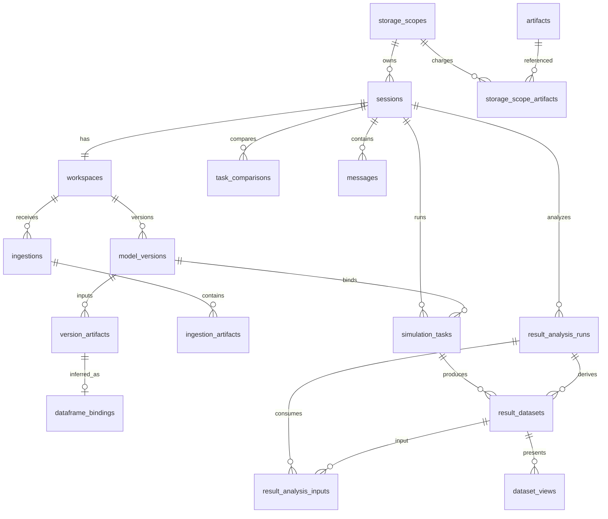

# 配电网仿真智能体 v2 数据库设计

> 状态：已实现。权威 SQL 为
> `backend/migrations/00000000000000_initial/up.sql`。v2 仅支持空库初始化。

## 1. 约定

- SQLite 启用外键；主键用 `INTEGER PRIMARY KEY AUTOINCREMENT`。
- 时间为 Unix 毫秒 `INTEGER`，出网转换为 ISO 8601；文件大小和行数使用 64 位整数。
- JSON 保存在 TEXT，写入前使用 canonical JSON；应用层校验其 schema。
- 每个 repository 查询显式接收 access scope；子资源通过 session join 校验归属。
- blob 路径是 DATA_DIR 内的相对路径，客户端和 LLM 永远看不到服务器路径。

## 2. 表关系

## 3. 身份、会话和搜索

- `storage_scopes`：计费主体、artifact/字节硬限制、使用量和告警比例。
- `sessions`：access scope、storage scope、标题和 `title_source=default|auto|user`。
- `messages`：八类消息的可读摘要和 payload；可选关联 task。
- `chat_search_documents` + `chat_search_fts`：session 标题、用户/助手文本、附件名和任务摘要。
  触发器保持外部内容 FTS 同步，`rebuild-search-index` 可离线重建。

session 的 scope 列和 storage scope 外键均为 NOT NULL。手工标题不会被首条消息的自动标题覆盖。

## 4. Artifact 与摄取

- `artifacts`：全局 SHA-256、逻辑大小、格式、媒体类型和 CAS 相对路径。
- `storage_scope_artifacts`：每个计费主体对 artifact 的引用计数；同 scope 相同内容只计一次。
- `artifact_gc_failures`：物理删除失败的幂等重试记录。
- `ingestions`：`workspace_id + client_batch_id` 唯一，持久化阶段、基线、发布版本和错误。
- `ingestion_artifacts`：client file ID、相对路径、原始/解包/规范化角色和单文件状态。

文件先流式写 staging，事务检查配额并登记引用后原子发布。失败不会推进 workspace 或留下可见的部分
版本。

## 5. 工作区和不可变版本

- `workspaces`：一个 session 一行，保存 active/draft 指针。
- `model_versions`：父版本、状态、source/origin、manifest、patch 和 content hash。
- `version_artifacts`：版本内输入及安全相对路径；可追溯 source artifact 和 Excel sheet。
- `dataframe_bindings`：基于列名的类型、置信度、决议、列 schema 和完整推断证据。

触发器禁止更新已发布的 model version、version artifact 和 binding。active 只能指向同 workspace 的
ready 版本；激活和回退只移动指针，不改历史任务。

## 6. 仿真任务

`simulation_tasks` 的可复现字段全部必填：

| 字段 | 说明 |
|---|---|
| `session_id` | 所属会话 |
| `status/stage` | 后端任务状态和阶段 |
| `study_type/study_spec_json` | 开放分析类型及完整参数 |
| `model_version_id` | 不可变输入版本 |
| `script_artifact_id` | 实际执行的 RSS |
| `agent_bundle_version/agent_skill_refs_json` | 生成脚本时的 agent 合同 |
| `engine_contract_version` | tensoreval 命令/结果合同 |
| `exit_code/error_json` | 执行结果或结构化错误 |
| 三个时间戳 | 创建、开始、完成 |

schema 不包含通用 `params_json`、任务路径表或预设领域统计值。

## 7. 通用结果、分析与比较

- `result_datasets`：只属于一个 simulation task 或 analysis run，保存 artifact、名称、schema/hash、
  行数和字节数。成功数据统一为 Snappy Parquet。
- `result_analysis_runs`：用户意图、RSS script artifact、状态、agent/skill/engine 版本。
- `result_analysis_inputs`：有序 dataset/alias 血缘。
- `dataset_views`：六类受控 `VisualizationSpec`，不保存任意 ECharts option。
- `task_comparisons`：基准/候选任务、固化的兼容性快照和差值 analysis run。

分析结果仍是普通 DataFrame。统计、筛选、聚合和差值不拆成 SQL 指标列；用户提出问题时由 RSS 读取
Parquet 并产出派生数据集。

## 8. 配额和删除

默认每个 storage scope 20,000 个唯一 artifact、20 GiB，80% 告警。删除 session 会级联删除其业务
记录；artifact 引用归零后由 GC 删除 blob 并扣减计数。达到硬限制时保持历史读、搜索和下载可用。

## 9. 发布迁移

v2 发布前已把开发期迁移压为一份 `00000000000000_initial`。部署时必须删除旧开发数据库和 DATA_DIR
后从空目录启动。此后 schema 变更恢复永久只追加迁移规则。
