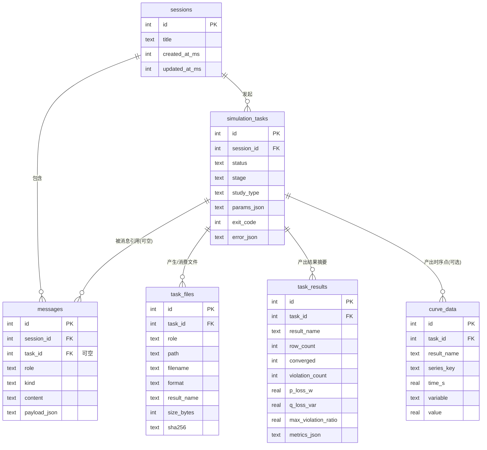

# 数据库层设计（SQLite + Diesel）

> 版本：v1 草案 · 状态：待评审
> 配套迁移：`backend/migrations/00000000000000_initial/`
> 说明：本文只描述设计，不包含任何 Rust 业务代码。引擎结论以 `../eig-rs/sparrowzz/dss/docs/` 为准，与 `AGENTS.md` 冲突处已在 §0.4 标注。

---

## 0. 前提：仿真引擎的真实形态（本设计的依据）

先厘清引擎“实际上是什么”，DB 设计才有根据。以下来自只读调研
`../eig-rs/sparrowzz/dss/docs/`（README、agent_quickstart、simulation_recipes、
dataframe_schema_reference、validation_and_troubleshooting、catalog/*）。

### 0.1 输入形态：不是“模型路径 + 一个参数对象”，而是「模型 + 脚本 + 可选数据文件」

- 输入的主载体是一段 **RSS 脚本**（`.rss`，RustScriptSimulation），由 agent 生成。脚本里
  `import_dss("path/model.dss")` 导入静态模型，随后构造研究表（`solution`、`load_shape`、
  `shape_assignment` 等）和参数表 `para`，再调用 DSA 函数（`ds_radial_pf`、`ds_radial_qsts`
  等）。
- 模型是一个 **`.dss` 入口文件**，可通过 `Redirect`/`#include` 引用更多文件（可能是一个
  文件树）。对应地，引擎提供 `.rssbundle` 把入口 + 被引用文件打包成自包含单体。
- 外部数据（负荷时序、PV 曲线、储能 profile 等）通过 `#include`/`#include_url` 读脚本文本，
  或通过 `--input NAME=FILE` 注入 CSV/XLSX/Parquet 表，再由 RSS 输入函数读取。
- **结论**：`simulation_tasks.params_json` 存的是「agent 友好的紧凑快照」（模型路径、分析
  类型、`result` 选择、QSTS 时间设置、外部数据引用），完整 `.rss` 脚本作为文件存
  `task_files`（`role='script'`），而不是塞进 params JSON。

### 0.2 输出形态：同步返回命名 DataFrame（表），可逐表落成 CSV

- `tensoreval --df case.rss` 是**同步 CLI**：进程退出码 0 表示成功，非 0 表示失败。
- 输出是一组**命名结果表**（named DataFrames），由 `para.result` 决定请求哪些、按什么顺序
  返回。常用：`bus_phase`/`bus_voltage`（电压）、`branch_flow`（线路/变压器功率与损耗）、
  `source_flow`、`load_state`、`storage_state`、`energy_meter`、`meter_loss_breakdown`、
  `summary`（收敛/迭代/总损耗/越限数）、`violations`、`execution_trace`/`diagnostics`/`events`
  （仅执行计划类入口产出）。
- **可直接落文件**：`tensoreval --df --result-dir DIR case.rss` 会把每个命名结果写成
  `DIR/结果名.csv`。这是「曲线存文件」策略的自然集成点。
- 关键列已确认（单位 V/A/W/var/VA/ohm，角度 rad，谐波角度 degree）：
  - `summary`: `converged, p_loss, q_loss, violation_count, max_violation_ratio, ...`
  - `violations`: `kind, element, bus, phase, value, limit, ratio`
  - `bus_phase`: `bus, phase, v_re, v_im, v_mag, v_ang`
  - `branch_flow`: 支路电流/功率/损耗 + 绕组 tap（30 列左右，含 `p_loss, q_loss`）
  - QSTS 结果额外追加 `time, load_multiplier, generation_multiplier`

### 0.3 任务生命周期：引擎无状态/无进度，生命周期由后端编排

- 执行是**同步、进程级单线程**：`tensoreval` 入口是普通 `fn main()`（无 `#[tokio::main]`），
  全程无 `.await` / `thread::spawn` / `rayon::par_*`；一次进程 = 一次 case，跑完即退出，
  求解期间阻塞发起方。
- 限定：`mems` crate 依赖里虽有 `rayon` 与可选 `tokio`，但那是给 Web 服务主程序
  （`tools` feature）用的，CLI 不启动 tokio 运行时；polars 内部可能做数据级并行，属库
  实现细节、不可依赖。
- 引擎**没有** task_id、异步进度、阶段状态机的概念。它要么一次跑完（退出码 0 + 结果表），
  要么失败（退出码非 0 + `diagnostics`/`events` 或解析错误）。`summary.converged` 是收敛的
  唯一权威信号。
- “模型检查”对应脚本里 `import_dss(...)` 的解析步骤：fail-closed，有诊断就整体失败。
- **结论**：`simulation_tasks` 的 `status/stage/created/started/finished` 是**后端强加的
  编排抽象**，不是引擎概念。推荐阶段枚举：`model_check → script_gen → running →
  collecting → (succeeded | failed)`。

### 0.4 与 AGENTS.md 的冲突点（引擎为准）

| 项 | AGENTS.md 描述 | 引擎实际 | 本设计取 |
|---|---|---|---|
| 调用形态 | 适配器返回 `async`，`reqwest` 访问内核服务 | 同步 CLI `tensoreval`，无 HTTP 服务 | 引擎为准：适配器用子进程跑 CLI，外层用 `spawn_blocking` 包成异步 |
| `run_simulation` 返回值 | `task_id`（异步任务 ID） | 无 task_id，同步返回结果表 | `task_id` = 本系统 `simulation_tasks.id`（后端生成），与引擎无关 |
| `inspect_model` 返回值 | 硬编码 `"model ok"` | `import_dss` 解析（fail-closed + 诊断） | 模型检查 = 脚本 import 步骤，结果落在 task 的 stage/error_json |
| 错误码 | 适配器翻译内核错误码 | 稳定 `category/code` + 诊断 message | 保留：错误码翻译仍在适配器，`error_json` 存结构化诊断 |

> 对 DB 设计本身影响不大，但必须写清楚：不要把 `task_id`、异步进度误当成引擎能力。

### 0.5 并发与限流：同步阻塞带来的编排约束

- 引擎是**同步批处理**而非常驻服务：求解为 CPU 密集的阻塞计算，一个进程同一时刻只算一个
  case。
- 后端并发跑仿真必须**排队/限流**（信号量或任务队列，例如同时最多 N 个引擎子进程），否则
  多个子进程抢占 CPU 核，反而变慢。
- 这也是「曲线存文件、DB 只存元数据」的同一推理起点：把一次性的同步计算包装成有状态、
  可追溯的异步任务，责任在后端编排层，不在引擎。

---

## 1. 实体关系图



关系说明（文字）：

- `sessions 1—N messages`：一个会话包含多条消息。
- `sessions 1—N simulation_tasks`：一个会话发起多个仿真任务。
- `simulation_tasks 1—N messages`（可空）：一条“工具调用卡片 / 结果卡片”消息可以指向某个任务；
  一条消息最多关联一个任务，一个任务可被多条消息引用。删除任务**不**删除消息（`SET NULL`）。
- `simulation_tasks 1—N task_files / task_results / curve_data`：任务的产物。删除任务级联删除产物
  （`CASCADE`，文件本体由存储层另行清理，DB 只删元数据行）。

### 为什么 `messages` 和 `simulation_tasks` 要分开

1. **生命周期不同**：消息是 append-only 的对话记录，一旦写入基本不变；任务有独立状态机
   （`pending → running → succeeded/failed`）和多个时间戳，会随进度反复更新。塞进消息 JSON 会导致
   每次状态变更都要改写整条消息，且无法高效 `WHERE status='running'` 轮询。
2. **引用完整性**：`task_files/task_results/curve_data` 都外键到 `simulation_tasks.id`。若任务内嵌在
   消息 JSON 里，这些外键就变成“JSON 里的引用”，SQLite 无法约束、无法索引。
3. **多对多/多对一**：一条消息引用一个任务，一个任务可被多条消息引用（如“运行卡片”+“结果卡片”）。
   这天然是一张独立表的关系，不是消息 JSON 的字段。
4. **体量与关注点分离**：结果/曲线是批量数据，有自己的存储策略（文件）；消息是聊天文本。内联会
   让 messages 表膨胀并污染其单一职责。

---

## 2. 表结构设计

### 通用约定

- **主键**：一律 `INTEGER PRIMARY KEY AUTOINCREMENT`（SQLite 推荐；Diesel 映射为 `i64`）。
- **时间戳**：一律 `INTEGER`（Unix 纪元，**毫秒**），列名后缀 `_ms`。
  - 理由：子消息/工具调用可能在同一秒内连发，需要亚秒精度排序；INTEGER 天然可比较、可建索引、
    无时区/格式歧义；Diesel 直接映射 `i64`，无需 `chrono` 特性。
  - 代价：不如 ISO8601 TEXT 可读，读库调试时需转换；可接受，展示层负责格式化。
  - 消息内排序用 `(session_id, id)` 兜底（`id` 单调递增），避免 ms 相撞。
- **布尔**：用 `INTEGER`（0/1），Diesel 映射 Rust `bool`（SQLite 无 BOOLEAN）。
- **JSON 边界**：所有 JSON 一律存 `TEXT`（SQLite 无 JSONB）。规则见 §2.6。

### 2.1 sessions

| 列 | 类型 | 约束 | 说明 |
|---|---|---|---|
| `id` | INTEGER | PK AUTOINCREMENT | |
| `title` | TEXT | NOT NULL DEFAULT '' | 会话标题（取首条用户消息截断，或手动改名） |
| `created_at_ms` | INTEGER | NOT NULL | |
| `updated_at_ms` | INTEGER | NOT NULL | 每次新消息/新任务时刷新，用于历史列表按最近排序 |

索引：`idx_sessions_updated ON sessions(updated_at_ms)`（历史列表排序）。

### 2.2 simulation_tasks

| 列 | 类型 | 约束 | 说明 |
|---|---|---|---|
| `id` | INTEGER | PK AUTOINCREMENT | 即对外暴露的 `task_id` |
| `session_id` | INTEGER | NOT NULL FK→sessions, CASCADE | |
| `status` | TEXT | NOT NULL | `pending/running/succeeded/failed/cancelled` |
| `stage` | TEXT | NULL | 后端编排阶段：`model_check/script_gen/running/collecting` |
| `study_type` | TEXT | NULL | `power_flow/qsts/harmonic/fault/...`（DSA 函数族，便于筛选展示） |
| `params_json` | TEXT | NOT NULL | 参数快照（模型路径、study_type、result 选择、QSTS 时间设置、外部数据引用） |
| `exit_code` | INTEGER | NULL | 引擎退出码 |
| `error_json` | TEXT | NULL | 结构化错误/诊断（`diagnostics`/`events` 或适配器错误） |
| `created_at_ms` | INTEGER | NOT NULL | |
| `started_at_ms` | INTEGER | NULL | |
| `finished_at_ms` | INTEGER | NULL | |

索引：
- `idx_tasks_session_time ON simulation_tasks(session_id, created_at_ms)`（会话内任务时间线）
- `idx_tasks_status ON simulation_tasks(status)`（轮询/清理运行中任务）

### 2.3 messages

| 列 | 类型 | 约束 | 说明 |
|---|---|---|---|
| `id` | INTEGER | PK AUTOINCREMENT | |
| `session_id` | INTEGER | NOT NULL FK→sessions, CASCADE | |
| `task_id` | INTEGER | NULL FK→simulation_tasks, SET NULL | 卡片消息关联的任务 |
| `role` | TEXT | NOT NULL | `user/assistant/tool` |
| `kind` | TEXT | NOT NULL | `text/tool_call/tool_result/result_card/error` |
| `content` | TEXT | NOT NULL DEFAULT '' | 纯文本（用户消息、助手文本、卡片的一句话摘要） |
| `payload_json` | TEXT | NULL | 卡片结构化数据（工具参数、结果摘要） |
| `created_at_ms` | INTEGER | NOT NULL | |

索引：
- `idx_messages_session_time ON messages(session_id, created_at_ms)`（会话内时间线）
- `idx_messages_task ON messages(task_id)`（反查某任务关联的消息）

> `content` 与 `payload_json` 的分工：文本类消息用 `content`；卡片类消息 `content` 存一行可读摘要，
> `payload_json` 存机器可读结构。避免“一列既放纯文本又放 JSON”的歧义。

### 2.4 task_files（文件元数据；曲线体量文件的归属地）

| 列 | 类型 | 约束 | 说明 |
|---|---|---|---|
| `id` | INTEGER | PK AUTOINCREMENT | |
| `task_id` | INTEGER | NOT NULL FK→simulation_tasks, CASCADE | |
| `role` | TEXT | NOT NULL | `input_model/input_data/script/output_curve/report/diagnostics` |
| `path` | TEXT | NOT NULL | 相对 `DATA_DIR` 的路径（DB 可整体迁移） |
| `filename` | TEXT | NOT NULL | 原始/展示文件名 |
| `format` | TEXT | NULL | `dss/csv/parquet/rss/json` |
| `result_name` | TEXT | NULL | `output_curve` 对应的结果名（`bus_phase/branch_flow/...`） |
| `size_bytes` | INTEGER | NULL | |
| `sha256` | TEXT | NULL | 内容哈希（去重、完整性、bundle 校验对齐） |
| `created_at_ms` | INTEGER | NOT NULL | |

索引：
- `idx_files_task_role ON task_files(task_id, role)`
- `idx_files_sha256 ON task_files(sha256)`（可选，供去重）

### 2.5 task_results（结构化结果摘要，供对话中快速展示/对比）

“小结果”全量入 `metrics_json`；“大结果（曲线）”只入摘要 + 指向 `task_files`。

| 列 | 类型 | 约束 | 说明 |
|---|---|---|---|
| `id` | INTEGER | PK AUTOINCREMENT | |
| `task_id` | INTEGER | NOT NULL FK→simulation_tasks, CASCADE | |
| `result_name` | TEXT | NOT NULL | `summary/violations/bus_phase/branch_flow/...` |
| `row_count` | INTEGER | NOT NULL DEFAULT 0 | 结果行数 |
| `converged` | INTEGER | NULL | 0/1，仅 `summary` 填 |
| `violation_count` | INTEGER | NULL | 仅 `summary` 填 |
| `p_loss_w` | REAL | NULL | 总网损 W，仅 `summary` 填 |
| `q_loss_var` | REAL | NULL | 总网损 var，仅 `summary` 填 |
| `max_violation_ratio` | REAL | NULL | 最大越限比，仅 `summary` 填 |
| `metrics_json` | TEXT | NOT NULL | 完整摘要：`summary`→全量指标；`violations`→越限列表；曲线→`{n_times,n_series,columns}` 摘要 |
| `created_at_ms` | INTEGER | NOT NULL | |

索引：
- `idx_results_task_name UNIQUE (task_id, result_name)`（每个任务每类结果一行）
- `idx_results_task ON task_results(task_id)`

> 归一化列（`converged/violation_count/p_loss_w/...`）用于“对比两个任务网损/越限”这类排序/比较
> 查询，避免解析 JSON；非 `summary` 结果这些列为 NULL。

### 2.6 curve_data（可选：需在 SQL 内查询的时序点）

> 见 §5.2 结论：**全量曲线推荐存文件**，本表仅用于「小型/降采样、需要在 SQL 里按
> `series_key + time_s` 查询或聚合」的场景（例如历史列表的迷你预览线）。v1 可不启用。

| 列 | 类型 | 约束 | 说明 |
|---|---|---|---|
| `id` | INTEGER | PK AUTOINCREMENT | |
| `task_id` | INTEGER | NOT NULL FK→simulation_tasks, CASCADE | |
| `result_name` | TEXT | NOT NULL | |
| `series_key` | TEXT | NOT NULL | 设备/母线/相标识（如 `bus.phase` 或 `element.terminal.phase`） |
| `time_s` | REAL | NOT NULL | 仿真时间（秒），QSTS 的 `time` |
| `variable` | TEXT | NOT NULL | `v_mag/p/q/i_mag/...` |
| `value` | REAL | NOT NULL | |

索引：`idx_curve_task_name_key_time ON curve_data(task_id, result_name, series_key, time_s)`。

### 2.7 JSON 字段边界总结

**适合 TEXT 存 JSON（整体读写，不参与 WHERE/JOIN/排序）**：
- `simulation_tasks.params_json`、`simulation_tasks.error_json`
- `messages.payload_json`（工具参数、结果卡片结构）
- `task_results.metrics_json`（各类结果的摘要/小结果全量）

**必须拆独立列（要查询/排序/外键）**：
- 主键/外键（`id`、`session_id`、`task_id`）
- 任务状态与阶段（`status`、`stage`）
- 时间戳（`*_ms`）
- 可排序的关键指标（`converged/violation_count/p_loss_w/q_loss_var/max_violation_ratio`）
- 消息 `role`/`kind`（过滤维度）

**原则**：SQLite 的 JSON 只是 TEXT，`json_extract()` 可用但不走索引；凡热路径（排序、过滤、关联）
字段必须独立成列。不要为“可能以后会查”提前拆列，以后需要时再加迁移。

---

## 3. Diesel 集成要点

### 3.1 Cargo.toml feature

```toml
diesel = { version = "2.2", features = ["sqlite", "r2d2"] }
```

- `sqlite`：`diesel::sqlite::SqliteConnection`。
- `r2d2`：`diesel::r2d2::ConnectionManager<SqliteConnection>` 连接池（服务器必需）。
- `chrono`：**不需要**。时间戳用 `i64` 毫秒，避免引入时间类型与 UTC 转换复杂度。

### 3.2 SQLite PRAGMA（每次建连后执行）

SQLite 默认：外键 OFF、无锁等待、journal 模式为 delete。服务器并发下必须逐连接设置：

```sql
PRAGMA foreign_keys = ON;      -- 外键约束（Diesel 不会自动开）
PRAGMA journal_mode = WAL;     -- 读写并发：一写多读
PRAGMA busy_timeout = 5000;    -- 锁等待 5s，而不是立即 SQLITE_BUSY
PRAGMA synchronous = NORMAL;   -- WAL + NORMAL 的性能/持久性平衡
```

- **时机**：`foreign_keys/busy_timeout/synchronous` 是**每连接**属性，必须在每个新连接上执行；
  `journal_mode=WAL` 是库文件级属性，设置一次即持久，但建连时再设一次幂等无副作用。
- **实现**：用 r2d2 的 `Builder::connection_customizer(Box::new(MyPragmaCustomizer))` 在每个连接
  初始化时跑上述 PRAGMA，或自定义 `establish()` 函数。不要只在启动时设一次。

### 3.3 异步：`tokio::task::spawn_blocking`

Diesel 是同步阻塞库。Axum 处理器是异步的，**不能直接在 async 上下文里调 Diesel**，否则阻塞
事件循环。做法：

```rust
use diesel::r2d2::{Pool, ConnectionManager};
use diesel::sqlite::SqliteConnection;

type DbPool = Pool<ConnectionManager<SqliteConnection>>;

async fn list_messages(state: axum::extract::State<DbPool>, ...) -> Result<..., ...> {
    let pool = state.clone();
    let rows = tokio::task::spawn_blocking(move || -> Result<Vec<Message>, diesel::result::Error> {
        use crate::schema::messages::dsl::*;
        let mut conn = pool.get()?;      // 阻塞闭包内部从池取连接
        messages.filter(session_id.eq(sid)).load::<Message>(&mut conn)
    })
    .await                       // 等待 JoinHandle
    .map_err(...)?               // spawn_blocking 的 panic/取消
    ?;                           // Diesel 错误
    Ok(rows)
}
```

要点：池用 `Arc`/`State` 共享；`pool.get()` 与所有 Diesel 调用都在阻塞闭包内执行，跑在 blocking
线程池上，不占 async worker。

### 3.4 迁移管理：手写 SQL + 目录结构

- **推荐手写 SQL**（不用 `diesel migration generate` + schema diff）：本设计一次定稿、字段明确，
  手写能精确控制 SQLite DDL（类型、索引、外键、注释），避免 diesel 自动生成的不必要差异。
- 目录（Diesel 约定，位于 crate 根 `backend/` 下）：

  ```text
  backend/migrations/
    └── 00000000000000_initial/
        ├── up.sql
        └── down.sql
  ```

- **执行方式二选一**：
  1. 开发期用 `diesel migration run`（CLI，读 `DATABASE_URL`）；
  2. 运行时在启动时执行 `diesel_migrations::embed_migrations!()` 自动升级（生产更稳，无需 CLI）。
     - 需追加 feature：`diesel = { features = ["sqlite", "r2d2", "diesel_migrations"] }`。
- 本任务**只创建 SQL 文件，不运行迁移**。

---

## 4. 迁移草案

见 `backend/migrations/00000000000000_initial/up.sql` 与 `down.sql`。

要点：建表顺序按依赖（父先于子）；所有时间戳 INTEGER 毫秒；外键 `ON DELETE CASCADE` / `SET NULL`
按 §1 约定；`curve_data` 保留但标注为可选。

---

## 5. 容量估算与曲线存储策略

### 5.1 容量估算

基准案例：**24h / 15min 步长 = 96 时间点，50 节点 × 3 相 = 150 个 (bus, phase) 键**。

| 结果 | 行数 | 列 | CSV 体积（估） | Parquet 体积（估） |
|---|---|---:|---:|---:|
| `bus_phase`（电压） | 96 × 150 = 14,400 | 6 | ~0.9 MB | ~0.15 MB |
| `branch_flow`（支路） | 96 × ~70 支路 ≈ 6,700 | ~30 | ~1.5–2 MB | ~0.3 MB |
| `summary/violations/load_state/...` | 很小 | — | <100 KB | — |
| **单个 QSTS 任务合计** | | | **~3 MB** | **~0.5 MB** |

- 若曲线存 SQLite `curve_data` 长表：`bus_phase` 4 个数值 × 14,400 = **57,600 行**，且每行冗余
  `series_key` 文本 + 行开销，约 **8–12 MB**（CSV 的 3–4 倍、Parquet 的 ~50 倍），查询回放还需
  把数万行按 key/time 重组为数组。
- 100 个任务：文件方案 ~300 MB CSV / ~50 MB Parquet；SQLite 方案 ~1 GB+，备份/VACUUM/清理都更重。

### 5.2 结论：曲线存文件，DB 只存元数据

**推荐**：
- 全量曲线由适配器写成**文件**，`--result-dir DIR` 已天然支持（每结果一个 CSV）；DB 里
  `task_files` 存 `path/sha256/size/result_name`，`task_results` 存每类结果的摘要
  （`row_count`、`{n_times,n_series,columns}`）供卡片快速展示。
- 格式：**v1 用 CSV**（简单、无损、ECharts 直读、`--result-dir` 直接产出）；量上来后切 **Parquet**
  （列式 + 压缩，体积/读取双赢），`task_files.format` 字段已预留。
- 存储根：约定 `DATA_DIR`（env），子目录 `models/ uploads/ scripts/ outputs/ reports/`；
  `task_files.path` 存**相对路径**，保证 DB 可整体搬迁。

**为什么不存 SQLite**：
1. 曲线是批量数值，按整块读取喂给 ECharts，不需要 SQL 按 `WHERE bus/time` 细粒度查询。
2. 行式存储体积大 3–50 倍，且回放要重组成数组，慢。
3. 文件方案让备份/清理/去重（sha256）都更简单，且与引擎 `--result-dir` 直接对接。

**什么时候才用 `curve_data` 表**：只在确实需要在 SQL 里按 `series_key + time_s` 查询/聚合的小型
或降采样序列（如历史列表迷你预览线）时启用；v1 不启用，保留表定义留作后路。

---

## 6. 待确认 / 后续

- [ ] `DATA_DIR` 的环境变量名与默认路径（建议 `DATA_DIR`，默认 `backend/data/`，加入 `.gitignore`）。
- [ ] 结果摘要 `metrics_json` 里 `violations` 是否要拆成独立 `task_violations` 表（当前按小结果入
      JSON；若将来要“跨任务查某节点越限”再升级）。
- [ ] 文件本体删除策略：`ON DELETE CASCADE` 只删元数据行，磁盘文件由存储层定期清理或任务级清理。
- [ ] `--result-dir` 之外，确认 `--df` 直连 stdout 的序列化格式（JSON/CSV），据此固化适配器解析。
