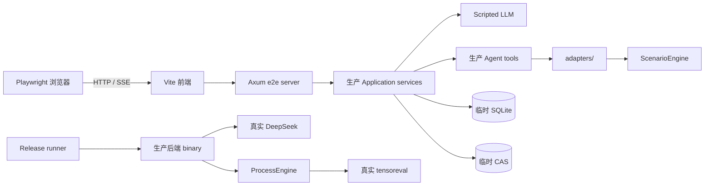

# v2 自动化集成测试设计

> 状态：已于 2026-10-23 落地。本文定义“100% 功能覆盖”的验收口径；它不表示
> 100% 源码行覆盖，也不表示穷举所有数据组合。系统架构见 [architecture.md](architecture.md)，HTTP/SSE
> 合同见 [api-design.md](api-design.md)，发布环境要求见 [v2-deployment.md](v2-deployment.md)，详细任务见
> [2026-10-22-v2-integration-testing.md](superpowers/plans/2026-10-22-v2-integration-testing.md)。

## 1. 目标和覆盖口径

自动化验收必须覆盖设计文档声明的每一项用户可见功能、公开接口、Agent 工具、输入格式、消息类型、
可视化类型、权限边界、恢复机制和明确的失败行为。覆盖率按功能目录计算：

```text
功能覆盖率 = 有自动化断言且在指定门禁执行的功能项 / 全部适用功能项
```

发布条件是功能覆盖率 100%，且不存在 `manual-only`、没有理由的 `skip` 或未关联测试的功能项。源码行、
分支和 mutation coverage 作为实现质量指标单独报告，不替代功能覆盖率。组合爆炸通过等价类、边界值和
风险场景处理；例如 97 个案例都验证可发现和可导入，每类引擎能力至少选择一个代表案例真实运行，
无需对每个案例穷举全部 study、参数和图表组合。

覆盖依据按以下优先级冻结：

1. `frontend/src/types/` 的前后端字段和枚举；
2. `api-design.md` 的 HTTP/SSE 合同；
3. `architecture.md`、`db-design.md`、`frontend-design.md`、`model-workspace-design.md`、
   `agent-prompt-skills-design.md` 的行为；
4. `v2-deployment.md` 的启动、安全和发布约束。

发现实现与设计不一致时，先决定修实现还是修设计，再更新功能目录。测试不能通过固化偶然行为来消除
差异。

## 2. 可执行功能目录

新增 `integration-tests/catalog/features.yaml` 作为功能覆盖的机器可读索引。每一项至少包含：

```yaml
- id: INPUT-CSV-001
  source: docs/model-workspace-design.md#5-基于表头的-dataframe-类型推断
  title: 根据 CSV 表头推断模型类型
  layers: [api, browser]
  lanes: [pr]
  tests:
    - backend/tests/dataframe_ingestion.rs::infers_table_kind_from_headers
    - integration-tests/e2e/dataframe-workspace.spec.ts
  assertions:
    - ingestion 进入 ready 或 collecting
    - 推断证据和缺失列在工作区可见
  fixtures: [dataframes/valid-csv]
```

`scripts/check-functional-coverage` 在 CI 中校验：

- ID 唯一，来源文档和测试文件存在；
- 每项至少有一个自动化测试和一个业务断言；
- 所有公开端点、八类消息、Agent 工具、六类图表、六个 skill、输入格式和稳定错误码都被目录枚举；
- `pr` 项在 PR 门禁执行，`release` 项在发布门禁执行；
- 测试结果中的功能 ID 与目录一致，最终生成总数、通过数和缺口报告；
- Playwright 按测试记录实际成功响应的 method/path；PR 门禁要求每个公开路由合同由目录所关联且已通过的
  浏览器测试真实命中，不能用任意通过的测试名代替；
- 新增或修改功能而未更新目录时 CI 失败。

测试源码以 `@feature ID` 或等价元数据关联目录。一个测试可以覆盖多个功能项，但每个功能项必须有独立
断言，不能只因为测试进程退出码为 0 就标记为覆盖。

## 3. 测试架构



确定性链路使用真实浏览器、前端构建、Axum 路由、领域服务、SQLite、CAS、SSE、Agent 调度和工具实现；
只替换两个不稳定的外部边界：LLM 和仿真进程。这样 PR 可以稳定验证用户看到的完整行为，同时发布门禁
再验证真实 DeepSeek 和 tensoreval 的合同。

### 3.1 e2e server

后端增加只在 `e2e-test` feature 下编译的测试入口。它监听 loopback 随机端口，使用测试独占的临时
SQLite 和 DATA_DIR，并注入 `ScriptedLlm`、`ScenarioEngine`、可控时钟和测试 fixture。生产 binary
不注册测试控制路由，也不能在外部依赖缺失时自动退回测试实现。

测试控制接口只允许 loopback 且要求每次启动生成的随机 token，用于预置下一次 LLM 响应、引擎故障、
时钟和断线条件。接口在编译期与生产 router 隔离。

### 3.2 Scripted LLM

Scripted LLM 返回 Rig 正常消费的 assistant/tool-call 事件，所有调用仍经过生产调度器、prompt、工具
权限、持久消息和 SSE。脚本按测试场景匹配用户意图，并记录收到的 system prompt、已加载 skill、上下文
和工具结果。测试断言工具名、稳定资源 ID、参数、顺序、持久副作用及最终自然语言结果，不匹配具体措辞。

它必须提供以下场景：正常单工具/多工具调用、补充提问、无工具回答、非法工具、缺少 skill、超时、流式
中断、provider 错误和重试后成功。

### 3.3 ScenarioEngine

`ScenarioEngine` 实现生产 `SimEngine` 接口，因此 Agent 工具仍只能通过 `backend/src/adapters/` 调用
引擎。它生成具有真实 Arrow schema 的 Snappy Parquet，并支持成功、多数据集、进程失败、超时、空
result-dir、损坏 Parquet、超限输出、目录穿越和符号链接等场景。禁止在 tool 或 application service 中
加入仅为测试绕过 adapter 的路径。

## 4. 四级门禁

| 层级 | 运行时机 | 环境 | 作用 |
|---|---|---|---|
| L0 单元/合同 | 每次 PR | Rust + Vitest | 算法、repository、adapter 合同、组件和 reducer 快速回归 |
| L1 确定性全链路 | 每次 PR | Playwright + Vite + Axum + SQLite/CAS + Scripted LLM + ScenarioEngine | 覆盖全部用户功能和跨层合同 |
| L2 韧性/安全 | 每次 PR；耗时分片可 nightly 重跑 | 多浏览器 context、重启和故障注入 | 并发、隔离、恢复、配额和失败原子性 |
| L3 真实依赖 | 候选发布 | DeepSeek + 当前合同的 release tensoreval | 验证 prompt/tool 选择和外部二进制实际兼容 |

L0、L1、L2 不依赖网络。L3 允许使用 secret，禁止在日志中输出 prompt 内的用户数据、API key 或完整
上传内容。L3 在普通 PR 可以不运行，但发布 job 不得静默跳过；缺少 binary、密钥或 engine snapshot
均视为发布环境配置失败。

## 5. 功能覆盖矩阵

下表定义功能目录的顶层集合。实施时每个范围拆成独立 ID，目录校验器要求所有 ID 都有测试结果。

| ID 前缀 | 必须覆盖的行为 | 主要层级 |
|---|---|---|
| BOOT | 空库 migration；capability、文档/catalog/案例、prompt/skill hash 校验；不兼容时拒绝接流量 | L0/L2/L3 |
| AUTH | instance、trusted proxy、缺失/错误 token、伪造 header、tenant scope、跨 scope 统一 404 | L0/L1/L2 |
| SESSION | 创建、列表、重命名、删除、分页、恢复最后会话、失效导航偏好回退 | L1 |
| MESSAGE | 八类消息持久化和渲染；乐观消息替换；Markdown；旧 session 响应不污染当前页 | L0/L1 |
| SSE | 先订阅后快照、稳定去重、Last-Event-ID 补发、断线重连、gap 后 resync、控制事件 | L0/L1/L2 |
| SCHED | session 串行、owner 2、实例 8、队列 32、第 33 项 429 且不写消息、引擎并发 4 | L0/L2 |
| UPLOAD | 单/多文件、目录、相对路径、新 batch/file ID、50/500 MiB 边界、失败后可重传 | L1/L2 |
| INPUT-RSS | 单 RSS 识别、诊断、替换、移除、重传后保留历史版本 | L0/L1 |
| INPUT-BUNDLE | ZIP/目录 rssbundle、manifest/依赖、安全解包、重复路径、穿越、符号链接、压缩炸弹 | L0/L1/L2 |
| INPUT-DF | CSV、Parquet、Excel 多 sheet；分批补传；列名推断；文件/sheet 名只展示 | L0/L1 |
| INFERENCE | 高置信命中、未知、歧义、缺列、dtype 冲突、同类型重复、对话确认映射 | L0/L1 |
| WORKSPACE | active/draft、collecting/ready、诊断、不可变父子版本、替换/移除/修改/激活/回退 | L0/L1 |
| EXAMPLE | 97 个案例 snapshot、搜索/详情、全部可导入、依赖复制、导入后修改、不写共享目录 | L0/L1/L3 |
| AGENT | prompt 合同、短生命周期 run、上下文恢复、工具白名单、skill gate、稳定 ID、拒绝路径/命令/SQL | L0/L1/L3 |
| STUDY | 潮流、短路、QSTS、谐波和开放 study；spec 校验；绑定版本/RSS/bundle/skills/engine | L0/L1/L3 |
| TASK | queued/running/succeeded/failed；进度；列表/详情；失败原子性；旧任务绑定旧版本 | L0/L1/L2 |
| DATASET | 多结果发现、schema/单位/行数、cursor 分页、列顺序、null、重复行、Parquet 下载和血缘 | L0/L1/L3 |
| ANALYSIS | 查 schema、生成受控 RSS、读取已有 Parquet、派生 Parquet、alias、脚本和 skill 引用固化 | L0/L1/L3 |
| VIEW | line、bar、scatter、heatmap、boxplot、histogram；非法字段；单位；规模 422；刷新恢复 | L0/L1 |
| COMPARE | 两任务选择、名称/稳定键/dtype/单位/QSTS 时间兼容、差值 DataFrame、不可比原因、恢复 | L0/L1 |
| HISTORY | 最近/older/around；trigram；1–2 字有界 LIKE；任务/时间过滤；FTS 故障不影响普通读取 | L0/L1/L2 |
| STORAGE | SHA-256 去重、20,000/20 GiB、80% 告警、并发原子配额、硬限只阻止新 artifact、GC | L0/L1/L2 |
| UI | 桌面三栏、可调宽度、窄屏抽屉、上传队列、局部错误、加载/空状态、键盘和基础无障碍 | L1 |
| LEGACY | 原型 schema/CSV 结果/固定 metrics/curves/report/运行时回退均不存在 | L0/L1 |

### 5.1 全部 HTTP/SSE 端点

每个端点至少覆盖成功、认证失败、跨 scope/不存在资源，以及该端点定义的参数边界和稳定错误码：

| 资源 | 端点 |
|---|---|
| 系统/身份 | `GET /health`、`GET /api/me` |
| 会话 | `GET/POST /api/sessions`、`PATCH/DELETE /api/sessions/{id}` |
| 消息/SSE | `GET/POST /api/sessions/{id}/messages`、`GET /api/sessions/{id}/events` |
| 上传 | `POST /api/sessions/{id}/attachments` |
| 历史 | `GET /api/history/search` |
| 案例 | `GET /api/examples`、`GET /api/examples/{id}` |
| 工作区/版本 | `GET /api/sessions/{id}/workspace`、`GET /api/sessions/{id}/versions`、`GET /api/versions/{id}`、`GET /api/ingestions/{id}` |
| 任务 | `GET /api/sessions/{id}/tasks`、`GET /api/tasks/{id}` |
| 数据集 | `GET /api/tasks/{id}/datasets`、`GET /api/datasets/{id}`、`GET /api/datasets/{id}/rows`、`GET /api/datasets/{id}/download` |
| 分析/视图/比较 | `GET /api/analysis-runs/{id}`、`GET /api/dataset-views/{id}/data`、`GET /api/task-comparisons/{id}` |
| 存储 | `GET /api/storage-usage` |

API 枚举测试从 production router manifest 获取实际路由，与目录双向比较：新路由没有目录项或目录仍引用
已删除路由都会失败。

### 5.2 全部 Agent 工具和 skill

工具 manifest 与覆盖目录双向比较。每个工具至少测试允许路径、越权/非法参数路径、持久副作用和可恢复
错误：

```text
inspect_workspace        search_examples            inspect_example
import_example           remove_model_input         replace_model_input
confirm_dataframe_mapping modify_model              activate_model_version
rollback_model_version   run_study                  run_result_analysis
create_dataset_view      compare_simulations        list_simulation_history
list_result_datasets     search_chat_history        read_chat_context
get_storage_usage
load_agent_skill         search_engine_docs         read_engine_doc_section
```

六个 skill（model-intake、study-planning、rss-generation、result-analysis、comparison、
troubleshooting）分别验证按需加载、工具 gate、hash 固化和错误 skill/tool 组合被拒绝。真实 LLM 验收以
工具轨迹和领域状态为准，不断言模型逐字输出。

设计审查已发现当前实现存在一项待修复差异：agent manifest 声明 `get_storage_usage`，但 `build_tools`
未注册它；`build_tools` 注册 `list_result_datasets`，但 manifest 未声明它。目标合同包含两者。实施第一批
测试时先统一 manifest、工具实现和 system prompt，再用双向枚举测试锁定。

## 6. 关键浏览器旅程

L1 至少执行以下完整旅程。每条旅程的关键用户动作从页面完成，并通过公开 API/SSE 观察结果；批量历史数据准备、跨身份安全探针和故障注入可通过公开测试 API 建立前置条件，但不得据此替代被验收的页面动作：

1. **DataFrame 潮流**：创建会话 → 分批上传 CSV/Excel/Parquet → 查看表头推断和缺项 → 对话确认
   歧义 → 激活版本 → 自然语言发起潮流 → 查看任务进度 → 表格分页/下载 → 创建六类视图。
2. **RSS 重传**：上传错误 `.rss` → 看到诊断 → 上传新文件 → 自然语言替换 → 确认父子版本和旧输入仍
   可追溯 → 仿真 → 修改参数 → 重跑 → 比较两次结果。
3. **rssbundle 与案例**：上传目录和 ZIP 两种 bundle → 验证依赖 → 搜索并导入内置案例 → 修改副本 →
   运行对应 study → 确认共享案例未变化。
4. **结果问答**：针对已有任务自然语言提问 → Agent 读取 schema → 执行分析 RSS → 生成派生
   DataFrame/视图 → 刷新后恢复分析和图表。
5. **历史恢复**：积累超过一页消息 → 搜索/around/older → 刷新和 SSE 断线重连 → 重命名/删除会话 →
   验证 last-session 回退和其他 session 状态隔离。
6. **多人隔离**：两个浏览器 context 代表不同 owner/tenant，验证列表、ID 猜测、下载、SSE、搜索均隔离。
7. **容量和失败**：触发 80% 告警、硬配额、队列满、LLM 失败、引擎失败/超时和图表超限，确认错误可见、
   输入可重试、已发布数据不回滚、半成品不发布。
8. **响应式工作台**：桌面和窄屏完成上传、对话、工作区、任务和结果查看；验证焦点、可访问名称和键盘
   可达性。

## 7. 故障、安全和恢复矩阵

| 故障点 | 注入方式 | 必须断言 |
|---|---|---|
| LLM 超时/错误/中断 | Scripted LLM | run 终止、错误消息持久化、调度 permit 释放、可重试 |
| 引擎非零退出/超时 | ScenarioEngine | task failed、诊断脱敏、无结果发布、临时目录清理 |
| 空/坏/超限 Parquet | ScenarioEngine | 合同错误稳定、数据库/CAS 不出现部分发布 |
| result-dir 穿越/符号链接 | ScenarioEngine | 拒绝越界文件，不能读取或发布 DATA_DIR 外内容 |
| SQLite 写失败 | fault injection | 事件不会先于事务发布，刷新后状态一致 |
| SSE 丢帧/断线/旧游标 | proxy/control endpoint | 补发或 resync，无重复业务消息 |
| 并发配额竞争 | barrier 并发请求 | 计数不超限，不出现负数或孤儿引用 |
| 恶意归档 | fixtures | 穿越、绝对路径、重复路径、炸弹和 symlink 被拒绝 |
| 伪造身份头 | 第二 browser context | trusted proxy token 失败，资源不可枚举 |
| FTS 索引故障 | 替换/损坏测试索引 | 搜索明确失败，普通历史仍可读 |
| 服务重启 | 杀死并重启 e2e server | 已提交消息/任务/视图恢复，运行中任务按合同收敛 |

所有异步测试等待可观察状态或 SSE 事件，禁止固定 `sleep`。失败时保存 Playwright trace、浏览器截图、
后端结构化日志和去敏后的 scenario trace。

## 8. 测试数据和真实依赖验收

fixture 必须小、确定、可审查，并包含 CSV、Excel 多 sheet、Parquet、单 RSS、安全/恶意 bundle 和多
结果 Parquet。每个 fixture 记录来源、schema、预期行数、单位和 SHA-256；不得包含生产用户数据。

L3 候选发布执行：

- 当前 `TENSOREVAL_CWD` 的 docs/catalog/全部 97 个案例 hash 和导入验证；
- 命名 Parquet 输入、`--result-dir`、`--output-format parquet`、expr_df 和 Snappy 编码合同；
- DataFrame 潮流、RSS 短路，以及覆盖 QSTS、谐波和开放 study 能力的代表案例；
- 一次真实结果问答、派生 DataFrame、参数修改重跑和任务比较；
- DeepSeek 在给定 prompt/skill 下只调用允许工具，使用稳定 ID，并得到预期领域终态。

真实 LLM 用例允许语言表述变化。它们对工具调用集合/先后依赖、参数 schema、最终任务/数据集/版本状态
使用语义断言；对暂时性 provider 错误按受控次数重试，重试耗尽即发布失败，不能改成跳过。

## 9. CI、报告和发布规则

实施后的统一入口为：

```bash
# L0
cd backend && cargo fmt --all -- --check && cargo test --features e2e-test
cd frontend && npm test -- --run && npm run build

# L1 + L2
npm run test:e2e
./scripts/check-functional-coverage --require-pr

# L3（候选发布；真实 secret 和 binary 由环境注入）
./scripts/test-release-integration
./scripts/check-functional-coverage --require-release
```

CI 归档 JUnit、功能覆盖 JSON/HTML、Playwright trace 和真实引擎合同报告。门禁规则：

- PR：L0/L1/L2 全绿，适用功能覆盖率 100%，无非预期 skip；
- 候选发布：在 PR 条件上增加 L3 全绿，全部 release 功能项覆盖率 100%；
- 已知缺陷只能以带到期日和 issue 的 quarantine 项存在，且功能覆盖率仍显示缺口，因此不能发布；
- flaky 重跑仅用于收集证据，首次失败仍进入报告，禁止用无限重跑制造绿色结果。

`--require-pr` 和 `--require-release` 都会从生产二进制读取合同 manifest，双向校验 27 个路由、八类消息、
22 个工具、六个 skill、六种上传来源、六类视图和 37 个稳定错误码。每个合同在目录中只有一个独立 ID；
合同必须关联真正执行对应行为的测试。PR 路由合同还会读取
`target/functional-coverage/e2e-routes.ndjson` 的逐测试运行时响应证据；路由/工具/枚举注册表测试只能校验清单，
不能作为合同行为证据。缺项、
重复项、未知项、测试声明不存在、lane 没有对应 runner、`manual-only` 或 skip 都会使门禁失败。
报告同时写入 `target/functional-coverage/*.json` 和 `*.html`，成功时 `covered == total` 且
`coveragePercent == 100`。

## 10. 落地验收标准

自动化集成测试子系统完成时必须同时满足：

1. 功能目录覆盖本文全部顶层范围，并与路由、消息、工具、skill、格式和图表 manifest 双向一致；
2. 当前 12 个 Playwright 文件中的 18 个浏览器用例在 Chromium 稳定通过，关键响应式旅程另在窄屏
   viewport 通过；新增功能时按功能目录扩展用例，不把文件数当作覆盖率；
3. 两个 browser context 证明身份隔离，重启/断线/并发/配额/恶意文件场景全部自动化；
4. L1 使用生产前后端代码路径，只有 LLM 与 engine adapter 实现被依赖注入替换；
5. 发布任务真实调用 DeepSeek 和当前合同的 tensoreval，缺少依赖时明确失败；
6. CI 报告显示 PR 和 release 各自适用功能项为 100%，且能由功能 ID 追溯到需求、测试和断言；
7. `development-status.md` 和 `v2-deployment.md` 的验证状态改为与实际门禁一致。

当前仓库已实现 Playwright、Scripted LLM、ScenarioEngine、机器可读功能目录和真实 DeepSeek 发布链路。
普通 PR 由 `.github/workflows/ci.yml` 执行 L0/L1/L2 和严格 PR 目录门禁；候选发布由受保护环境中的
`.github/workflows/release-integration.yml` 在 PR 门禁后执行 L3 和严格发布目录门禁。2026-10-23 的本地候选
上一合同 `dss-v2-d2b6d88a` 已通过真实 DeepSeek/tensoreval 发布验收；当前合同
`dss-v2-b3fc74c0` 必须重新执行 L3。GitHub 发布记录以对应 workflow 归档的
`release-gate-evidence-*` 为准。
